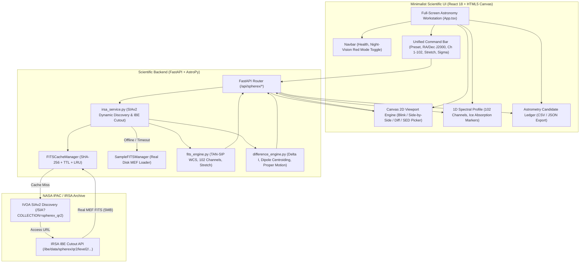

# Project: NASA Space Apps Challenge — Planet X & SPHEREx Explorer

## Architecture
The system is an advanced astronomical research and citizen science platform designed for detecting Planet X and distant trans-Neptunian objects using NASA SPHEREx Quick Release 2 (QR2) spectrophotometric all-sky survey data.

The application follows a decoupled client-server architecture:
1. **Scientific Backend (Python 3.10 / FastAPI / AstroPy / HTTPX / SciPy)**:
   - **IVOA SIAv2 & IBE Data Access Layer** (`backend/app/irsa_service.py`): Dynamically discovers SPHEREx Level 2 MEF image URLs via IVOA Simple Image Access (SIAv2) and fetches cutouts via Caltech-IPAC IRSA Image-Based Epoch (IBE) API. Strictly enforces Scientific Data Fidelity with zero mock fallbacks.
   - **Local Resilient Cache & Offline MEF Store** (`backend/data/cache/spherex/`, `backend/data/sample_fits/`): Deterministic SHA-256 disk caching with TTL expiration and LRU size limits. Bundles genuine 7-HDU Level 2 MEF FITS files on disk for offline operation.
   - **Astrometry & WCS Engine** (`backend/app/fits_engine.py`): Astropy TAN & TAN-SIP celestial projections ($6.15^{\prime\prime}/\text{px}$), subpixel coordinate transforms, percentile clipping, and astronomical stretches (`asinh`, `log`, `linear`).
   - **Clyde Tombaugh Difference & Dipole Engine** (`backend/app/difference_engine.py`): Subtraction ($\Delta I = E2 - E1$), Median Absolute Deviation ($\text{MAD}$) background noise estimation, connected-component dipole detection, and annual proper motion rate calculation ($\mu$ in arcsec/yr).
   - **REST API Router** (`backend/app/main.py`): High-performance endpoints serving structured astrometric JSON and Base64 PNGs.
2. **Minimalist Scientific Frontend (React 18 / TypeScript / Vite / Tailwind CSS / HTML5 Canvas)**:
   - **High-Efficiency Workstation Layout**: Full-screen viewport maximizing astronomical visualization space (eliminating the legacy 440px constraint).
   - **Five Core Observation Modes**:
     1. *Blink Comparator*: Variable-cadence multi-epoch cycling ($0.5-5.0\,\text{Hz}$), alignment reticle, pan/zoom.
     2. *Side-by-Side Synchronized*: Dual viewports with synchronized pan/zoom and linked crosshair tracking.
     3. *Difference Imaging*: Algebraic difference ($\Delta I$) with interactive $\sigma$-threshold slider and bipolar colormap.
     4. *Spectral Profile (1D SED)*: 102 spectrophotometric channels ($0.75-5.0\,\mu\text{m}$) with interactive 2D coordinate-to-spectrum picker and spectral ice absorption lines ($H_2O, CO_2, CH_4$).
     5. *Candidate Flagging & Export*: Candidate discovery ledger with client-side CSV and JSON export.
   - **Astrophotometry Tools**: Vector crosshairs, sexagesimal WCS readout (HMS/DMS), night-vision red monochrome mode.
3. **E2E Testing Infrastructure (Playwright / Pytest)**:
   - Automated headless browser tests verifying all 5 modes without console errors.
   - 75+ automated backend tests asserting real data fidelity (`TELESCOP == 'SPHEREx'`, `data_source == 'nasa_irsa_live'`).



## Feature Inventory
| # | Feature | Description | Milestone | Source |
|---|---------|-------------|-----------|--------|
| 1 | IVOA SIAv2 Dynamic Discovery | Spatial search querying `irsa.ipac.caltech.edu/SIA` to resolve direct Level 2 MEF `access_url`s for any target coordinates | Milestone 1 | Survey & R3 |
| 2 | NASA IRSA IBE Cutout Retrieval | Stream real Level 2 MEF FITS files with public access, 30s timeout, and GET stream protocol | Milestone 1 | Survey & R3 |
| 3 | Elimination of Mock / Synthetic Data | Remove or isolate `simulate_spherex_field`; refactor `SampleFITSManager` to load genuine disk FITS from `data/sample_fits/` | Milestone 1 | Survey & R3 |
| 4 | Real Multi-Channel SED Extraction | Compute real spectrophotometric flux density from FITS cutouts across all 102 channels ($0.75-5.0\,\mu\text{m}$) | Milestone 1 | Survey & R3 |
| 5 | Cache TTL & LRU Management | Implement cache expiration policies, bounding disk usage in `data/cache/spherex/` | Milestone 1 | Survey & R3 |
| 6 | Real Data Backend Verification Tests | Automated pytest assertions enforcing `data_source == 'nasa_irsa_live'`, `TELESCOP == 'SPHEREx'`, and valid TAN WCS | Milestone 1 | Survey & R3 |
| 7 | Full-Screen Workstation Layout | Expand viewport to full window, removing legacy 440px constraint and 75% screen waste | Milestone 2 | Survey & R2 |
| 8 | Mode 1: Blink Comparator Upgrade | HTML5 Canvas rendering, subpixel pan/zoom ($1\times-16\times$), variable cadence ($0.5-5.0\,\text{Hz}$), alignment reticle | Milestone 2 | Survey & R2 |
| 9 | Mode 2: Synchronized Side-by-Side | Dual synchronized viewports with linked pan/zoom and twin crosshair reticles tracking simultaneously | Milestone 2 | Survey & R2 |
| 10 | Mode 3: Difference Imaging ($\Delta I$) | Bipolar residual display with interactive $\sigma$-threshold slider ($2.0-10.0\sigma$) and dipole centroid rings | Milestone 2 | Survey & R2 |
| 11 | Mode 4: 1D Spectral Profile & Picker | 102-channel SED graph with interactive 2D coordinate-to-spectrum picker and spectral feature markers ($H_2O, CO_2, CH_4$) | Milestone 2 | Survey & R2 |
| 12 | Mode 5: Candidate Ledger & Export | Real-time moving object table with client-side CSV and JSON export buttons and discovery flag submission | Milestone 2 | Survey & R2 |
| 13 | Astrophotometry Tools & Night Vision | Sexagesimal WCS readout (HMS/DMS), IRAF `zscale` stretch, and observatory darkroom night-vision red mode | Milestone 2 | Survey & R2 |
| 14 | Clean Dead Legacy Components | Remove unused legacy files (`CoordinateSearch.tsx`, `BandSelector.tsx`, `AstrometryPanel.tsx`) | Milestone 2 | Survey & R1 |
| 15 | Playwright E2E UI Test Suite | 8 automated browser test scenarios verifying all 5 modes without runtime console errors | Milestone 3 | Project Spec & R2 |
| 16 | Fullstack Integration & Stress Verification | End-to-end integration tests covering live IRSA queries, cache hit, offline fallback, and adversarial inputs | Milestone 3 | Project Spec & R3 |
| 17 | Comprehensive User Documentation | Complete user guide, scientific operations manual, IRSA QR2 ingestion guide, and candidate reporting protocol | Milestone 4 | R5 |

## Milestones
| # | Name | Scope | Dependencies | Status |
|---|------|-------|-------------|--------|
| 1 | M1: Backend Scientific Data Fidelity & Dynamic IRSA Pipeline | Backend: SIAv2 dynamic discovery, real FITS cutout ingestion, eliminate synthetic mock generator from production, read disk sample FITS, cache TTL/LRU, backend tests | none | DONE |
| 2 | M2: Minimalist Scientific UI & 5-Mode Viewport Engine | Frontend: Full-screen layout, HTML5 Canvas engine, Blink with pan/zoom, synchronized Side-by-Side crosshairs, Difference $\sigma$ slider, 2D coordinate-to-SED picker, CSV/JSON export, night-vision mode, clean dead code | M1 Interface Contract | IN_PROGRESS |
| 3 | M3: Playwright E2E Testing & System Verification | Test infra: Install `@playwright/test`, implement 8 test scenarios across 5 observation modes, execute backend + E2E suites with zero errors | M1, M2 | PLANNED |
| 4 | M4: Comprehensive User Documentation & Showcase | Documentation: User manual, operational guide, IRSA QR2 data ingestion workflow, candidate flagging protocols, competition showcase materials | M1, M2, M3 | PLANNED |

## Interface Contracts
### Frontend ↔ Backend REST API (`/api/spherex/*`)

#### 1. `GET /api/health`
- Response:
  ```json
  {
    "status": "healthy",
    "astropy_version": "6.1.3",
    "numpy_version": "1.26.4",
    "irsa_online": true
  }
  ```

#### 2. `POST /api/spherex/blink`
- Request:
  ```json
  {
    "ra": 304.6935,
    "dec": 42.4437,
    "channel_id": 60,
    "epoch1_id": "2025W19_2B",
    "epoch2_id": "2025W43_1A",
    "sigma_threshold": 3.5,
    "stretch": "asinh",
    "colormap": "magma"
  }
  ```
- Response:
  ```json
  {
    "ra": 304.6935,
    "dec": 42.4437,
    "channel_id": 60,
    "wavelength_um": 2.45,
    "band_name": "Band 3 (SWIR)",
    "data_source": "nasa_irsa_live",
    "epoch1": {
      "epoch_id": "2025W19_2B",
      "image_base64": "data:image/png;base64,...",
      "stats": { "min": 0.0, "max": 100.0, "mean": 10.5, "std": 3.2 }
    },
    "epoch2": {
      "epoch_id": "2025W43_1A",
      "image_base64": "data:image/png;base64,...",
      "stats": { "min": 0.0, "max": 100.0, "mean": 10.8, "std": 3.4 }
    },
    "difference": {
      "image_base64": "data:image/png;base64,...",
      "min_residual": -15.0,
      "max_residual": 18.0,
      "std_residual": 2.1
    },
    "spectral_profile": [
      { "channel_id": 1, "wavelength_um": 0.75, "flux_density": 12.3 },
      { "channel_id": 102, "wavelength_um": 5.00, "flux_density": 4.1 }
    ],
    "candidates_detected": [
      {
        "candidate_id": "SPX-CAND-001",
        "epoch1_pixel": [32.5, 40.1],
        "epoch2_pixel": [35.2, 43.8],
        "epoch1_world": [304.6940, 42.4438],
        "epoch2_world": [304.6945, 42.4442],
        "snr": 8.5,
        "angular_shift_arcsec": 1.84,
        "apparent_motion_arcsec_yr": 3.68,
        "detection_type": "dipole_positive_negative",
        "match_confidence": 0.94
      }
    ],
    "wcs": {
      "crval": [304.6935, 42.4437],
      "cdelt": [-0.00170833, 0.00170833],
      "ctype": ["RA---TAN-SIP", "DEC--TAN-SIP"]
    }
  }
  ```

#### 3. `POST /api/spherex/flag-candidate`
- Request:
  ```json
  {
    "ra": 304.6945,
    "dec": 42.4442,
    "channel_id": 60,
    "observer_name": "Dr. Astronomer",
    "classification": "Kuiper Belt Object",
    "notes": "Clear dipole detected in difference frame with 3.68 arcsec/yr proper motion"
  }
  ```
- Response:
  ```json
  {
    "status": "success",
    "message": "Candidate SPX-FLAG-... recorded successfully",
    "entry": { ... }
  }
  ```

## Code Layout
- `backend/app/irsa_service.py`: NASA IPAC/IRSA dynamic SIAv2 client, IBE cutout streaming, cache management, genuine sample loader.
- `backend/app/fits_engine.py`: Instrument constants, TAN-SIP WCS, channel catalog, stretch algorithms (`asinh`, `log`, `linear`, `zscale`), Base64 PNG encoder.
- `backend/app/difference_engine.py`: Difference image calculation, $\text{MAD}$ noise thresholding, dipole pairing, proper motion rate calculation.
- `backend/app/main.py`: FastAPI server, route definitions, CORS, error handling.
- `backend/data/cache/spherex/`: Local SHA-256 FITS cache directory and `cache_manifest.json`.
- `backend/data/sample_fits/`: Pre-bundled genuine SPHEREx Level 2 MEF FITS files.
- `backend/tests/`: Backend test suites (`test_api.py`, `test_fits_engine.py`, `test_irsa_service.py`, `test_e2e_pipeline.py`).
- `frontend/src/`:
  - `App.tsx`: Full-screen astronomy workstation layout.
  - `components/Navbar.tsx`: Minimalist header with AstroPy status and night-vision toggle.
  - `components/CompactToolbar.tsx`: Unified command bar with presets, coordinates, channel stepper, and controls.
  - `components/SkyViewer.tsx`: Canvas 2D observation engine supporting Blink, Side-by-Side, and Difference views.
  - `components/SpectralProfile.tsx`: 1D SED curve across 102 channels with interactive coordinate picker and ice markers.
  - `components/AstrometryLedger.tsx`: Moving object candidate table with CSV/JSON export.
  - `components/CandidateModal.tsx`: Candidate logging dialog.
- `frontend/e2e/`: Playwright browser test specs (`scientific_ui.spec.ts`).
- `docs/`: User manual and documentation guides (`USER_MANUAL.md`).
