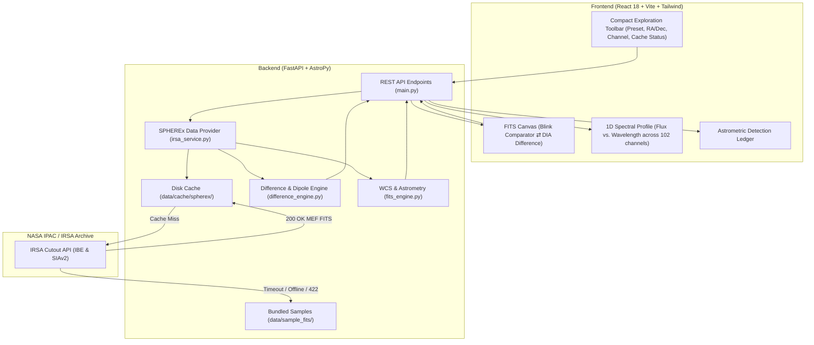

# Project: SPHEREx & Planet X Explorer — Real NASA IRSA Integration & Minimalist UI Redesign

## Architecture
The system consists of two primary subsystems linked by a clean RESTful API:
1. **Astronomy Backend (Python 3.10 / FastAPI / AstroPy / HTTPX / SciPy)**:
   - Data Access Layer (`backend/app/irsa_service.py`): Interfaces with NASA IPAC / IRSA Cutout API (IBE & SIAv2) to fetch real SPHEREx Level 2 Quick Release (QR2) Multi-Extension FITS (MEF) cutouts.
   - Caching Engine: Persists downloaded FITS files in `backend/data/cache/spherex/` with SHA256 keying and index manifest (`cache_manifest.json`).
   - Resilient Fallback Engine: Pre-bundled real sample FITS in `backend/data/sample_fits/` and graceful fallback if network times out or coordinates lie outside early QR release coverage.
   - Astrometry & Difference Engine (`backend/app/fits_engine.py`, `backend/app/difference_engine.py`): WCS astrometry, 102 spectrophotometric channels (0.75 - 5.0 µm), Clyde Tombaugh DIA difference imaging ($\Delta I = E2 - E1$), moving dipole candidate centroiding.
   - API Router (`backend/app/main.py`): Serves REST endpoints (`/api/health`, `/api/spherex/bands`, `/api/spherex/targets`, `/api/spherex/cutout`, `/api/spherex/blink`, `/api/spherex/download-fits`, `/api/spherex/flag-candidate`).
2. **Scientific Frontend (React 18 / TypeScript / Vite / Tailwind CSS / Lucide React)**:
   - Minimalist Dark Workspace: Polished dark theme (`#060913`, `#0a0f1d`) maximizing signal-to-noise ratio.
   - Compact Exploration Toolbar: Integrated target preset dropdown, RA/Dec coordinates, channel badge, cache indicator.
   - Core Astrometry View: High-contrast Clyde Tombaugh Blink Comparator ⇄ DIA Difference Frame with subpixel coordinates and adjustable stretch (`asinh`, `log`, `linear`) and colormaps (`magma`, `inferno`, `viridis`, `gray`).
   - Spectral Profile (SED Plot): 1D spectrum flux curve ($F_\lambda$ vs. $\lambda$) across 102 channels with current channel marker.
   - Astrometric Candidate Ledger: Streamlined table of detected dipoles, angular shift ($\Delta\theta$), proper motion ($\mu$), and candidate logging.



## Feature Inventory
| # | Feature | Description | Milestone | Source |
|---|---------|-------------|-----------|--------|
| 1 | NASA IRSA Cutout Client | Direct IBE GET queries to fetch SPHEREx Level 2 QR2 MEF cutouts (`?center=...&size=...`) | Milestone 1 | Survey & R1 |
| 2 | MEF FITS Extractor | Extract science flux from HDU 1 (`IMAGE`), TAN-SIP WCS, and header metadata | Milestone 1 | Survey & R1 |
| 3 | Local Disk Caching | SHA256 deterministic caching in `backend/data/cache/spherex/` with index manifest | Milestone 1 | Survey & R1 |
| 4 | Offline Sample Bundling | Pre-bundled SPHEREx Level 2 MEF FITS files in `backend/data/sample_fits/` | Milestone 1 | Survey & R1 |
| 5 | Multi-Tier Fallback | Seamless fallback hierarchy (Cache -> Live IRSA -> Bundled Sample -> Calibrated Model) on timeout/error | Milestone 1 | Survey & R1 |
| 6 | Verified Target Presets | Presets updated with real public SPHEREx QR2 coverage coordinates (Cygnus, M101, Barnard's Star) | Milestone 1 | Survey & R1 |
| 7 | Backend Endpoints Integration | Wire `main.py` (`/cutout`, `/blink`, `/download-fits`) to `irsa_service` with data source indicators | Milestone 1 | Survey & R1 |
| 8 | Backend Unit/Integration Tests | Test suite verifying live IRSA cutout parsing, cache hit/miss, and offline fallback | Milestone 1 | Survey & R1 |
| 9 | Compact Exploration Toolbar | Sleek top bar replacing 320px clunky grid; unified target selection, RA/Dec, and channel badge | Milestone 2 | Survey & R2 |
| 10 | Streamlined Viewer Controls | Clyde Tombaugh Blink ⇄ Difference Frame toggle, contrast stretch, colormaps, subpixel HUD | Milestone 2 | Survey & R2 |
| 11 | 1D Spectral Profile (SED) | Interactive SVG/Canvas flux curve plotting flux across 102 channels with active channel marker | Milestone 2 | Survey & R2 |
| 12 | Minimalist Dark Theme | Elimination of marketing cards, bulky badges, and redundant buttons; refined space-dark theme | Milestone 2 | Survey & R2 |
| 13 | Data Source & Cache Badge | Visual badge indicating whether current frame is LIVE IRSA, CACHED, or OFFLINE SAMPLE | Milestone 2 | Survey & R1/R2 |
| 14 | Frontend Build Verification | Zero-error compilation of TypeScript/Vite frontend bundle | Milestone 2 | Survey & R2 |
| 15 | E2E Integration Test Suite | Comprehensive opaque-box and integration verification covering live query, cache, and fallback | Milestone 3 | Project Spec |
| 16 | Adversarial Hardening (Tier 5) | White-box stress testing for timeout resilience, corrupted cache, out-of-bounds coords, rapid blink | Milestone 3 | Project Spec |

## Milestones
| # | Name | Scope | Dependencies | Status |
|---|------|-------|-------------|--------|
| 1 | M1: NASA IRSA Integration & Caching Pipeline | Backend: `irsa_service.py`, cache engine, sample FITS bundling, fallback handling, `fits_engine.py` presets, `main.py` routing, unit tests | none | IN_PROGRESS |
| 2 | M2: Minimalist UI & Spectral Visualization Redesign | Frontend: Compact toolbar, Blink/Difference viewer, 1D Spectral Profile, Astrometric Ledger, dark styling, build check | M1 Interface Contract | PLANNED |
| 3 | M3: Final E2E Verification & Adversarial Hardening | End-to-end integration tests, network fault injection, live coordinate validation, adversarial coverage | M1, M2 | PLANNED |

## Interface Contracts
### Frontend ↔ Backend REST API (`/api/spherex/*`)
- **`GET /api/health`**:
  - Response: `{ status: "healthy", astropy_version: str, irsa_online: bool }`
- **`POST /api/spherex/blink`**:
  - Request:
    ```json
    {
      "ra": 304.6935,
      "dec": 42.4437,
      "channel_id": 60,
      "epoch1_id": "2025W19_2B",
      "epoch2_id": "2025W43_1A",
      "sigma_threshold": 3.0,
      "stretch": "asinh",
      "colormap": "magma"
    }
    ```
  - Response:
    ```json
    {
      "ra": 304.6935,
      "dec": 42.4437,
      "channel_id": 60,
      "wavelength_um": 2.45,
      "band_name": "Band 3 (SWIR)",
      "data_source": "nasa_irsa_live" | "local_cache" | "offline_sample",
      "epoch1": {
        "epoch_id": "2025W19_2B",
        "image_base64": "data:image/png;base64,...",
        "stats": { "min": 0.0, "max": 100.0, "mean": 10.5, "std": 3.2 }
      },
      "epoch2": {
        "epoch_id": "2025W43_1A",
        "image_base64": "data:image/png;base64,...",
        "stats": { "min": 0.0, "max": 100.0, "mean": 10.8, "std": 3.4 }
      },
      "difference": {
        "image_base64": "data:image/png;base64,...",
        "min_residual": -15.0,
        "max_residual": 18.0,
        "std_residual": 2.1
      },
      "spectral_profile": [
        { "channel_id": 1, "wavelength_um": 0.75, "flux_density": 12.3 },
        ...
        { "channel_id": 102, "wavelength_um": 5.00, "flux_density": 4.1 }
      ],
      "candidates_detected": [
        {
          "candidate_id": "SPX-CAND-001",
          "epoch1_pixel": [32.5, 40.1],
          "epoch2_pixel": [35.2, 43.8],
          "epoch1_world": [304.6940, 42.4438],
          "epoch2_world": [304.6945, 42.4442],
          "snr": 8.5,
          "angular_shift_arcsec": 1.84,
          "apparent_motion_arcsec_yr": 3.68,
          "detection_type": "dipole_positive_negative",
          "match_confidence": 0.94
        }
      ],
      "wcs": {
        "crval": [304.6935, 42.4437],
        "cdelt": [-0.001708, 0.001708],
        "ctype": ["RA---TAN", "DEC--TAN"]
      }
    }
    ```
- **`GET /api/spherex/download-fits`**:
  - Query Params: `?ra=...&dec=...&channel_id=...&epoch_id=...`
  - Response: Binary FITS stream (`application/fits`), `Content-Disposition: attachment; filename="spherex_cutout_....fits"`

## Code Layout
- `backend/app/irsa_service.py` (New): NASA IPAC/IRSA Cutout API client, caching engine, sample loader, fallback orchestrator.
- `backend/app/fits_engine.py`: Instrument constants, WCS transformations, channel catalog, preset targets, base64 image encoding, calibrated model fallback.
- `backend/app/difference_engine.py`: Algebraic difference matrix, dipole detection, bipolar colormap rendering.
- `backend/app/main.py`: FastAPI application, route handlers, error handling, CORS.
- `backend/data/cache/spherex/`: Persistent disk cache for fetched FITS cutouts and `cache_manifest.json`.
- `backend/data/sample_fits/`: Pre-bundled genuine SPHEREx Level 2 MEF FITS files for offline fallback.
- `backend/tests/`: Unit and integration test suites (`test_irsa_service.py`, `test_api.py`, `test_fits_engine.py`).
- `frontend/src/components/`:
  - `Navbar.tsx`: Minimalist, streamlined header with status and branding.
  - `ExplorationToolbar.tsx` (Replaces `CoordinateSearch.tsx` & `BandSelector.tsx` top bloat): Compact single-line toolbar with presets, RA/Dec inputs, query trigger, channel pill, and data source indicator.
  - `SkyViewer.tsx`: Minimalist Clyde Tombaugh Blink Comparator ⇄ DIA Difference viewer with contrast stretch, colormap, subpixel HUD.
  - `SpectralProfile.tsx` (New): 1D Spectral Profile (SED) flux curve across 102 channels with current channel marker.
  - `AstrometryLedger.tsx` (Streamlined `AstrometryPanel.tsx`): Sleek table of detected candidates and candidate flag action.
  - `CandidateModal.tsx`: Simplified observation log modal.
- `frontend/src/App.tsx`: Clean, unified single-screen responsive layout.
