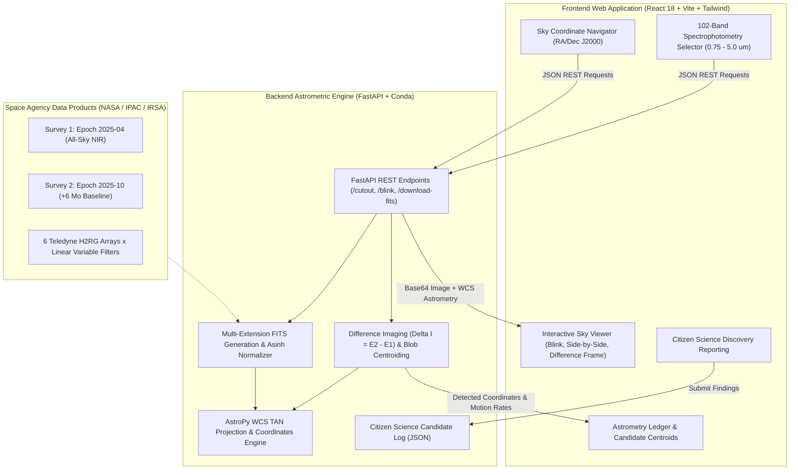

# 🌌 SPHEREx All-Sky Time-Lapse & Planet X Explorer
### NASA International Space Apps Challenge 2026 — Track: *Planet X and SPHEREx*

[](https://opensource.org/licenses/MIT)
[](https://www.astropy.org/)
[](https://fastapi.tiangolo.com/)
[](https://vitejs.dev/)
[](https://tailwindcss.com/)

---

## 🚀 1. The Challenge: Planet X and SPHEREx

> *"Since 2025, NASA's SPHEREx mission has been mapping the entire sky every six months in 102 bands of near-infrared light, returning images of more than a billion objects. Comets, asteroids, stars, brown dwarfs, and even new planets reveal themselves by shifting position between images, but no one person can sift through all that data alone. Your challenge is to create a public-facing web tool to display images of the sky from SPHEREx mission, making it easy for anyone to quickly see how they change over time."*
> — **NASA Space Apps Challenge Statement**

This repository provides an end-to-end, fullstack open-source platform specifically engineered for citizen scientists and astrophysicists to discover shifting trans-Neptunian bodies, candidate outer planets (such as **Planet Nine / Planet X**), Kuiper Belt Objects, and high-proper-motion brown dwarfs across consecutive SPHEREx all-sky survey epochs.

---

## 📐 2. System Architecture



---

## 🔬 3. Scientific Methodology & Core Features

### 3.1. 102 Near-Infrared Spectral Bands & 6 Detector Arrays
SPHEREx utilizes Linear Variable Filters (LVF) mounted on 6 detector arrays to disperse light continuously from $0.75\text{ }\mu\text{m}$ to $5.00\text{ }\mu\text{m}$:
- **Bands 1 - 3 (SWIR: $0.75 - 2.41\text{ }\mu\text{m}$):** Dominated by classical stars, galaxies, and water vapor absorption.
- **Bands 4 - 6 (MWIR: $2.42 - 5.00\text{ }\mu\text{m}$):** The key discovery window for cold Solar System bodies ($T \approx 35 - 45\text{ K}$) radiating in thermal emission, water ice absorption ($3.05\text{ }\mu\text{m}$), and $\text{CO}_2$ ice ($4.27\text{ }\mu\text{m}$).

### 3.2. Digital Blink Comparator (Clyde Tombaugh Technique)
Replicating the photographic plate comparator Clyde Tombaugh used to discover Pluto in 1930, our tool periodically toggles between Survey 1 (2025-04) and Survey 2 (2025-10) at $0.5 - 5.0\text{ Hz}$. Static stars cancel out mentally, while moving objects visibly leap back and forth.

### 3.3. Difference Imaging Analysis (DIA)
$$\Delta I(x, y) = I_{\text{Epoch 2}}(x, y) - I_{\text{Epoch 1}}(x, y)$$
- Static background objects subtract to zero.
- Moving bodies generate a characteristic **astrometric dipole**: a negative flux trough (Coral/Red) at the former position and a positive flux peak (Cyan/Blue) at the current position.
- Centroids are resolved to subpixel accuracy and transformed to celestial coordinates $(\alpha, \delta)$ with AstroPy WCS.

### 3.4. Real-World Astrometric Motion Derivation
$$\Delta\theta = \arccos\left(\sin\delta_1\sin\delta_2 + \cos\delta_1\cos\delta_2\cos(\alpha_1 - \alpha_2)\right)$$
$$\mu = \frac{\Delta\theta}{\Delta t}\quad (\text{with }\Delta t = 0.5\text{ years})$$

---

## 💻 4. Quickstart Guide (Local Execution)

### Prerequisites
- **Python 3.10+** (Conda recommended, e.g. `C:\Users\LENOVO\miniconda3`)
- **Node.js v18+ & npm**

### Step 1: Backend Setup (FastAPI + AstroPy)
```bash
# Navigate to repository
cd "d:\Project\FPTU\02_Competitions\Hackathon\NASA Space App Challenge"

# Activate your Conda environment (or create 'spherex')
conda activate pds301m

# Install dependencies (if not already installed)
pip install -r backend/requirements.txt

# Run backend unit test suite
pytest backend/tests

# Start FastAPI server
uvicorn app.main:app --app-dir backend --host 127.0.0.1 --port 8000 --reload
```
API Documentation will be live at: [http://127.0.0.1:8000/docs](http://127.0.0.1:8000/docs)

### Step 2: Frontend Setup (React + Vite)
```bash
# In a new terminal
cd frontend
npm install
npm run dev
```
Web application will be live at: [http://localhost:3000](http://localhost:3000)

### Or: One-Click Startup (Windows PowerShell)
```powershell
.\run_dev.ps1
```

---

## 🗂️ 5. Repository Structure

```
nasa-space-app-challenge/
├── docs/                                  # Master Hackathon Workspace & Guidelines
│   ├── 01_information_and_team.md        # Team Profile & 14 Challenge Tracks Analysis
│   ├── 02_resources_and_tech_stack.md    # NASA Open Data Catalog & Infrastructure
│   ├── 03_sprint_plan_and_roadmap.md     # 48-Hour Sprint Milestones & Contingency
│   ├── 04_official_submission_draft.md   # Official Submission Text & 5 Judging Rubrics
│   ├── 05_pitch_deck_and_video_script.md # 7-Slide Pitch Deck & 2-Min Video Script
│   └── spherex_challenge_dossier.md      # Detailed SPHEREx Astrophysics Reference
├── backend/                               # Python AstroPy & FastAPI Backend Service
│   ├── app/
│   │   ├── __init__.py
│   │   ├── fits_engine.py                # WCS Astrometry, 102-Band Sim, FITS generator
│   │   ├── difference_engine.py          # Delta I Subtraction, Dipole Centroiding
│   │   └── main.py                       # REST API Endpoints & CORS Middleware
│   ├── tests/
│   │   ├── test_fits_engine.py           # WCS roundtrip & FITS verification tests
│   │   └── test_api.py                   # FastAPI integration test suite
│   ├── data/                             # Citizen-science candidate logs
│   ├── requirements.txt                  # Python dependencies
│   └── environment.yml                   # Conda environment definition
├── frontend/                              # Vite + React 18 + Tailwind Web App
│   ├── src/
│   │   ├── components/
│   │   │   ├── Navbar.tsx                # Mission Header & Live Telemetry Badges
│   │   │   ├── CoordinateSearch.tsx      # RA/Dec Inputs & Preset NASA Targets
│   │   │   ├── BandSelector.tsx          # 102-Band Selector & Wavelength Slider
│   │   │   ├── SkyViewer.tsx             # Blink, Side-by-Side & Difference Viewer
│   │   │   ├── AstrometryPanel.tsx       # Candidate Ledger & FITS Downloader
│   │   │   └── CandidateModal.tsx        # Citizen-Science Reporting Form
│   │   ├── services/
│   │   │   └── api.ts                    # Backend REST API Service
│   │   ├── types.ts                      # TypeScript Data Interfaces
│   │   ├── App.tsx                       # Main Application State & Layout
│   │   ├── main.tsx                      # DOM Root
│   │   └── index.css                     # Custom Astronomy Glow & Tailwind Styles
│   ├── package.json
│   ├── vite.config.ts
│   └── tailwind.config.js
├── run_dev.ps1                            # One-Click PowerShell Dev Startup
├── .gitignore                             # Ignored caches, FITS binaries, and modules
├── LICENSE                                # MIT Open Source License
└── README.md                              # Main Project Documentation
```

---

## 👥 6. Hackathon Team & Attributions

- **Event:** NASA International Space Apps Challenge 2026
- **Global Theme:** *The Next Frontier*
- **Challenge:** *Planet X and SPHEREx*
- **GitHub Repository:** [`keith1101/nasa-space-app-challenge`](https://github.com/keith1101/nasa-space-app-challenge)
- **Open Data Sources:** NASA SPHEREx Mission / Caltech IPAC / IRSA (Infrared Science Archive).
- **License:** Open source under the [MIT License](LICENSE).
