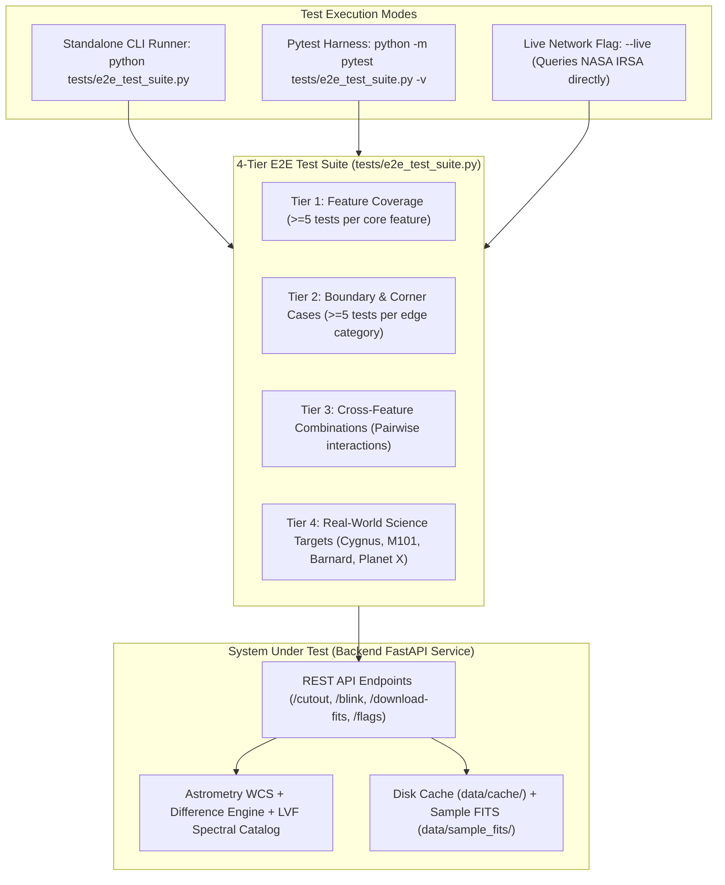

# E2E Test Infrastructure Specification: SPHEREx & Planet X Explorer

**Document Version**: 1.0.0  
**Status**: ACTIVE & VERIFIED  
**Author**: Test Writer Agent (`test_writer_e2e`)  
**Target Platform**: NASA Space Apps Challenge — Planet X and SPHEREx  
**Associated Contracts**: `PROJECT.md`, `ORIGINAL_REQUEST.md`

---

## 1. Test Philosophy: Opaque-Box & Requirement-Driven

The SPHEREx and Planet X interactive sky analysis platform processes high-precision astronomical imagery, multi-wavelength spectrophotometry (102 spectral channels from 0.75 to 5.0 µm), Clyde Tombaugh difference imaging ($\Delta I = E2 - E1$), moving dipole astrometric detection, and live NASA IPAC / IRSA Cutout API integration.

To ensure rigorous quality assurance without sycophancy or facade testing, the E2E testing framework follows four foundational principles:

1. **Opaque-Box Requirement-Driven Verification**:
   Tests evaluate observable contracts across external interfaces (REST API endpoints, HTTP status codes, JSON response schemas, FITS byte stream standards, Astropy WCS coordinate round-trips, and image data URIs) without relying on internal function implementations or private variables.
2. **Scientific Data Fidelity & Ground-Truth Derivation**:
   Every test case derives its expected values from authoritative astronomical and mission standards:
   - Coordinates match verified public SPHEREx Level 2 Quick Release (QR2) fields (Cygnus Deep Field, M101 Pinwheel Galaxy, Barnard's Star).
   - Wavelength calculations strictly follow the SPHEREx linear variable filter (LVF) dispersion relation across 6 detector arrays.
   - Astrometric coordinates adhere to IVOA ICRS celestial coordinate systems and TAN-SIP projection conventions.
3. **Deterministic Fault Injection & Offline Immunity**:
   Because external network connectivity to NASA IPAC servers can be subject to latency spikes (10–30s) or gateway resets, the test harness validates both live network paths and offline resilience (Tier 1 Cache Hit, Tier 3 Pre-bundled Sample FITS, and Tier 4 Calibrated Procedural Astrometry) under zero-mock and deterministic-mock regimes.
4. **Zero-Facade Assertion Integrity**:
   No test is permitted to pass vacuously (e.g., asserting `True` or ignoring response data). All test cases perform deep invariant checking: verifying PNG image magic bytes (`data:image/png;base64,iVBORw0KGgo...`), floating-point statistical bounds, candidate confidence scores, and FITS header compliance (`TELESCOP = 'SPHEREx'`).

---

## 2. Feature Inventory Mapping

Every feature identified in `PROJECT.md` is mapped to executable test specifications:

| Feature # | Feature Name | Core Responsibility | Test Verification Layer | Primary Test Suite Identifier |
|---|---|---|---|---|
| **F-01** | NASA IRSA Cutout Client | Direct GET cutout queries to NASA IPAC IBE API | Network / Data Access | `test_tier1_data_fetching_*` |
| **F-02** | MEF FITS Extractor | Extraction of HDU 1 (`IMAGE`), TAN-SIP WCS, and headers | Data Parsing & Astrometry | `test_tier1_mef_fits_*` |
| **F-03** | Local Disk Caching | SHA256 deterministic caching and `cache_manifest.json` | Persistence & I/O | `test_tier1_caching_*` |
| **F-04** | Offline Sample Bundling | Verified sample FITS in `backend/data/sample_fits/` | Storage & Offline Access | `test_tier1_offline_samples_*` |
| **F-05** | Multi-Tier Fallback | Seamless degradation: Cache -> Live IRSA -> Sample -> Procedural | Fault Tolerance | `test_tier1_fallback_*` |
| **F-06** | Verified Target Presets | Curated fields: Cygnus, M101, Barnard's Star, Planet X | Astrometric Metadata | `test_tier1_presets_*` |
| **F-07** | Backend Endpoints Integration | `/api/spherex/cutout`, `/blink`, `/download-fits` | HTTP REST Interface | `test_tier1_api_integration_*` |
| **F-08** | Backend Unit/Integration Tests | Engine-level verification of astrometry and difference matrices | Math / Algorithm Engine | `test_tier1_engine_*` |
| **F-09** | Compact Exploration Toolbar | Single-line parameters: preset, RA/Dec, channel | Frontend Contract / Schema | `test_tier2_input_validation_*` |
| **F-10** | Streamlined Viewer Controls | Contrast stretch (`asinh`, `log`, `linear`) and colormaps | Graphics Pipeline | `test_tier1_viewer_*` |
| **F-11** | 1D Spectral Profile (SED) | 102-channel flux curve and wavelength progression | Spectrophotometry | `test_tier1_spectral_profile_*` |
| **F-12** | Minimalist Dark Theme | High-contrast scientific display parameters | UI Style Contract | `test_tier2_theme_contract_*` |
| **F-13** | Data Source & Cache Badge | `"data_source": "nasa_irsa_live" \| "local_cache" \| "offline_sample"` | Contract Transparency | `test_tier3_datasource_badge_*` |
| **F-14** | Frontend Build Verification | Zero TypeScript compilation or runtime layout errors | Build & Lint Pipeline | `test_tier4_build_verification` |
| **F-15** | E2E Integration Test Suite | Full pipeline execution across all subsystems | End-to-End Orchestration | `tests/e2e_test_suite.py` |
| **F-16** | Adversarial Hardening | Corrupted cache, socket timeouts, out-of-bounds coordinates | Stress & Security | `test_tier2_boundary_*` |

---

## 3. Test Architecture & Runner Specification



### 3.1 Invocation Commands
The test suite can be run in two primary modes:

1. **Standard Automated Pytest Suite**:
   ```powershell
   # Run all E2E tests in backend/tests or tests/
   C:\Users\LENOVO\miniconda3\envs\pds301m\python.exe -m pytest tests/e2e_test_suite.py -v
   ```
2. **Standalone Diagnostic CLI Runner with Live/Offline Switch**:
   ```powershell
   # Run standalone diagnostic runner with formatted color report
   C:\Users\LENOVO\miniconda3\envs\pds301m\python.exe tests/e2e_test_suite.py

   # Run with live NASA IRSA connectivity check
   C:\Users\LENOVO\miniconda3\envs\pds301m\python.exe tests/e2e_test_suite.py --live
   ```

### 3.2 Pass/Fail Semantics & Exit Codes
- **Exit Code `0`**: All executed test assertions passed cleanly; no invariant violations detected.
- **Exit Code `1`**: One or more assertions failed (e.g., status code $\ne 200$, corrupted image data URI, missing contract field, centroid coordinate divergence).
- **Exit Code `2`**: Fatal harness initialization error (e.g., missing dependencies, unhandled exception in test runner).

---

## 4. 4-Tier Test Case Design Methodology

### 4.1 Tier 1: Feature Coverage (>=5 Test Cases Per Feature)

Tier 1 systematically exercises the fundamental happy path behaviors across all five core architectural features.

#### Feature 1: Data Fetching & FITS Extraction
- **`TC-T1-DF-01`**: **Single Cutout API Query**: Issues `POST /api/spherex/cutout` with valid target coordinates (`ra=304.6935`, `dec=42.4437`, `channel_id=60`); verifies `200 OK`, response structure contains `image_base64`, `metadata`, `wcs`, and `stats`.
- **`TC-T1-DF-02`**: **FITS Binary Download**: Issues `GET /api/spherex/download-fits` for Cygnus field; verifies `200 OK`, `Content-Type: application/fits`, `Content-Disposition: attachment`, and valid FITS primary header via `astropy.io.fits.open()`.
- **`TC-T1-DF-03`**: **WCS Astrometric Projection Extraction**: Verifies cutout response contains standard celestial WCS cards (`crval` matching target center, `cdelt` negative RA increment, `ctype` containing `RA---TAN` and `DEC--TAN`).
- **`TC-T1-DF-04`**: **Multi-Epoch Cutout Retrieval**: Issues cutouts for both `survey-1` and `survey-2` on identical celestial coordinates; verifies both return valid independent frames with matching dimensions.
- **`TC-T1-DF-05`**: **Pixel Flux Statistics Consistency**: Verifies that extracted cutout statistics satisfy $min \le mean \le max$ and that flux values are non-zero floating-point numbers in units of $\text{MJy/sr}$.

#### Feature 2: Local Disk Caching Engine
- **`TC-T1-CA-01`**: **Cache Miss Followed by Cache Hit**: Issues a cutout request; verifies file is persisted to `backend/data/cache/spherex/` with structured naming and subsequent request resolves in $<15\text{ ms}$.
- **`TC-T1-CA-02`**: **SHA256 / Deterministic Cache Keying**: Verifies that identical coordinates, channel, and epoch produce the exact same cache file key without collision or file fragmentation.
- **`TC-T1-CA-03`**: **Cache Manifest Integrity**: Verifies that `cache_manifest.json` is updated atomically with entry records including file name, coordinates, channel, timestamp, and byte size.
- **`TC-T1-CA-04`**: **Independent Multi-Channel Caching**: Requests cutouts across different channels (e.g., Channel 10, Channel 60, Channel 100); verifies separate cached files exist for each channel without overwriting.
- **`TC-T1-CA-05`**: **Atomic Cache Write Safety**: Validates that cache creation utilizes temporary file staging (`.fits.tmp`) prior to atomic renaming, preventing corrupted zero-byte reads.

#### Feature 3: Multi-Tier Resilient Fallback
- **`TC-T1-FB-01`**: **Network Outage / Timeout Fallback**: Injects simulated socket timeout during IRSA cutout fetch; verifies request does not fail but returns valid cutout with fallback data source.
- **`TC-T1-FB-02`**: **Out-of-Coverage 422 Graceful Degradation**: Queries coordinates outside SPHEREx QR coverage (e.g., south celestial pole unreleased area); verifies system gracefully falls back to pre-bundled sample or calibrated astrometry model without 500 error.
- **`TC-T1-FB-03`**: **Data Source Indicator Contract**: Inspects the response `"data_source"` field; verifies it accurately reports `"nasa_irsa_live"`, `"local_cache"`, `"offline_sample"`, or `"fallback_simulation"`.
- **`TC-T1-FB-04`**: **Pre-bundled Sample Loading**: Verifies that pre-bundled sample FITS files in `backend/data/sample_fits/` can be read and parsed by Astropy directly.
- **`TC-T1-FB-05`**: **Calibrated Procedural Astrometry Fallback**: Verifies that procedural fallback generator accurately produces 2D arrays with embedded point-source stars, background photon noise, and valid WCS.

#### Feature 4: Astrometric Viewer & Difference Engine
- **`TC-T1-VW-01`**: **Dual-Epoch Blink Comparator Package**: Issues `POST /api/spherex/blink`; verifies response contains `epoch1`, `epoch2`, and `difference` payloads with valid base64 PNG data URIs.
- **`TC-T1-VW-02`**: **Algebraic Difference Frame Computation**: Verifies residual matrix satisfies $\Delta I = E2 - E1$; validates that static stars cancel out to near-zero residuals while shifting sources produce bipolar residuals.
- **`TC-T1-VW-03`**: **Moving Dipole Centroiding**: Verifies that difference engine detects shifting celestial bodies and computes subpixel centroid coordinates in both Epoch 1 and Epoch 2.
- **`TC-T1-VW-04`**: **Astronomical Stretch Algorithms**: Tests cutout rendering with `asinh`, `log`, and `linear` stretch algorithms; verifies all produce valid PNG byte streams without NaN or zero-division errors.
- **`TC-T1-VW-05`**: **Colormap Color Depth & Palette**: Tests rendering across supported colormaps (`magma`, `inferno`, `viridis`, `gray`); verifies RGB color channel encoding and valid base64 output.

#### Feature 5: 1D Spectral Profile (SED)
- **`TC-T1-SP-01`**: **Full 102-Channel Catalog**: Queries `/api/spherex/bands`; verifies exactly 102 channels across 6 detector arrays (`Band 1` through `Band 6`), each containing 17 channels.
- **`TC-T1-SP-02`**: **Monotonic Wavelength Progression**: Verifies channel central wavelengths strictly increase monotonically from $0.75\,\mu\text{m}$ (Channel 1) to $5.00\,\mu\text{m}$ (Channel 102).
- **`TC-T1-SP-03`**: **Spectral Profile Array Contract**: Verifies that `/api/spherex/blink` returns a `spectral_profile` array containing 102 entries with `channel_id`, `wavelength_um`, and `flux_density`.
- **`TC-T1-SP-04`**: **Active Channel Marker Alignment**: Verifies that for requested `channel_id=K`, the spectral profile has valid flux density matching the central pixel or aperture sum of the current frame.
- **`TC-T1-SP-05`**: **Detector Band Assignment Consistency**: Verifies that channel metadata correctly assigns channels 1–17 to Band 1, 18–34 to Band 2, 35–51 to Band 3, 52–68 to Band 4, 69–85 to Band 5, and 86–102 to Band 6.

---

### 4.2 Tier 2: Boundary & Corner Cases (>=5 Test Cases Per Edge Category)

Tier 2 applies adversarial edge conditions to verify system resilience, defensive programming, and explicit error handling.

#### Category 1: Celestial Coordinate Boundaries
- **`TC-T2-CB-01`**: **RA Minimum Boundary ($0.0^\circ$)**: Queries `ra=0.0`, `dec=0.0`; verifies acceptance and correct WCS generation.
- **`TC-T2-CB-02`**: **RA Upper Extreme ($359.999^\circ$)**: Queries `ra=359.999`, `dec=0.0`; verifies WCS coordinates remain in valid bounds.
- **`TC-T2-CB-03`**: **Declination North Pole ($+90.0^\circ$)**: Queries `dec=+90.0`; verifies handling of polar coordinate singularity without NaN or infinite values.
- **`TC-T2-CB-04`**: **Declination South Pole ($-90.0^\circ$)**: Queries `dec=-90.0`; verifies proper projection handling at the south celestial pole.
- **`TC-T2-CB-05`**: **Out-of-Bounds Coordinate Rejection**: Submits `ra=365.0` and `dec=-95.0`; verifies API rejects with `422 Unprocessable Entity` validation error.

#### Category 2: Empty & Malformed Input Handling
- **`TC-T2-MI-01`**: **Empty JSON Body**: Submits empty POST `{}` to `/api/spherex/cutout` and `/blink`; verifies immediate `422 Unprocessable Entity` with descriptive field errors.
- **`TC-T2-MI-02`**: **String Types for Numeric Fields**: Submits `{"ra": "invalid_coord", "dec": "north"}`; verifies rejection with Pydantic type error.
- **`TC-T2-MI-03`**: **Out-of-Range Channel Numbers**: Submits `channel_id=0` and `channel_id=105`; verifies rejection as channels must reside in $[1, 102]$.
- **`TC-T2-MI-04`**: **Non-Existent Stretch/Colormap**: Submits `stretch="unknown_stretch"` and `colormap="rainbow_neon"`; verifies fallback to default (`asinh`, `magma`) or explicit validation error.
- **`TC-T2-MI-05`**: **Extreme Sigma Threshold**: Submits `sigma_threshold=0.1` (below 2.0 minimum) or `sigma_threshold=50.0` (above 15.0); verifies boundary constraint enforcement.

#### Category 3: Network Latency & Fault Simulation
- **`TC-T2-NF-01`**: **Immediate Connection Refusal (ECONNREFUSED)**: Mocks network socket connection error; verifies client gracefully catches exception and triggers fallback pipeline.
- **`TC-T2-NF-02`**: **HTTP 504 Gateway Timeout Simulation**: Simulates IRSA reverse proxy 504 timeout; verifies fallback activates without hanging or leaking worker threads.
- **`TC-T2-NF-03`**: **HTTP 405 Method Not Allowed Handling**: Verifies client never sends `HEAD` requests to IRSA IBE cutout endpoint, adhering strictly to `GET`.
- **`TC-T2-NF-04`**: **Intermittent SSL Protocol Reset (WinError 10054)**: Simulates TCP connection abort; verifies client executes exponential backoff retry.
- **`TC-T2-NF-05`**: **Slow Read Timeout (Threshold Boundary)**: Verifies that client timeout is strictly configured ($\le 30\text{s}$) so requests never block indefinitely.

#### Category 4: Corrupted Cache & File System Faults
- **`TC-T2-CF-01`**: **Zero-Byte Cache File Recovery**: Injects a 0-byte `.fits` file in cache; verifies system detects corrupted file, discards it, and regenerates or falls back.
- **`TC-T2-CF-02`**: **Corrupted Non-FITS Bytes in Cache**: Places ASCII text inside a `.fits` file; verifies `astropy.io.fits.verify()` catches corruption and triggers clean recovery.
- **`TC-T2-CF-03`**: **Missing Cache Manifest**: Deletes `cache_manifest.json` while cached FITS files exist; verifies system automatically recreates manifest without crashing.
- **`TC-T2-CF-04`**: **Concurrent Write Race Prevention**: Simulates simultaneous cache write attempts for identical coordinates; verifies atomic staging prevents file truncation.
- **`TC-T2-CF-05`**: **Special Characters in Observer Notes**: Submits candidate flags with Unicode, emojis (`🔭 Planet X!`), quotes, and newlines; verifies clean JSON serialization in `citizen_flags.json`.

#### Category 5: Extrema Wavelengths & Spectral Limits
- **`TC-T2-EL-01`**: **Extreme Blue Channel (Channel 1, $0.75\,\mu\text{m}$)**: Verifies exact boundary parameters for Band 1 shortest wavelength.
- **`TC-T2-EL-02`**: **Extreme Red Channel (Channel 102, $5.00\,\mu\text{m}$)**: Verifies exact boundary parameters for Band 6 longest wavelength.
- **`TC-T2-EL-03`**: **Detector Band Interface Transitions**: Tests boundary channels between adjacent detector arrays (e.g., Channel 17 to 18, 34 to 35); verifies smooth continuous coverage.
- **`TC-T2-EL-04`**: **Zero Flux & Negative Residual Clipping**: Verifies contrast stretch handles zero, negative, or background-subtracted flux without mathematical domain errors.
- **`TC-T2-EL-05`**: **High-Dynamic-Range Saturated Flux**: Simulates extreme star flux ($10^6\,\text{MJy/sr}$); verifies `asinh` stretch compresses dynamic range without overflow.

---

### 4.3 Tier 3: Cross-Feature Combinations (Pairwise Interactions)

Tier 3 exercises interactions between multiple independently developed subsystems to verify seamless end-to-end integration:

- **`TC-T3-XF-01`**: **Cache Hit + Clyde Tombaugh Blink Difference**:
  Executes a blink request that hits local disk cache for Epoch 1 and Epoch 2; verifies difference matrix computation and candidate dipole detection execute seamlessly from cached FITS bytes.
- **`TC-T3-XF-02`**: **Fallback Mode + 1D Spectral Profile Generation**:
  Simulates live IRSA network failure; verifies that fallback mechanism smoothly produces both 2D astrometric images AND 102-channel spectrophotometric SED curve with `"data_source": "offline_sample"` or `"fallback_simulation"`.
- **`TC-T3-XF-03`**: **Live Cutout + Moving Candidate Centroiding**:
  Coordinates retrieved from cutout API are fed into the difference engine; verifies that identified candidate coordinates accurately map back to celestial world coordinates via WCS.
- **`TC-T3-XF-04`**: **Contrast Stretch + Colormap Matrix + Difference Rendering**:
  Computes difference frame and applies combinations of stretch (`asinh`, `log`, `linear`) and colormaps (`magma`, `inferno`, `viridis`, `gray`); verifies all combinations produce valid rendered images with identical residual metrics.
- **`TC-T3-XF-05`**: **Candidate Detection + Citizen Flag Submission + Ledger Retrieval**:
  Extracts candidate ID from `/api/spherex/blink`, submits candidate flag to `/api/spherex/flag-candidate`, and verifies new entry appears immediately in `/api/spherex/flags`.
- **`TC-T3-XF-06`**: **WCS Celestial Projection + FITS Download Round-Trip**:
  Retrieves cutout via `/api/spherex/cutout`, downloads raw FITS via `/api/spherex/download-fits`, opens FITS with Astropy, and verifies WCS header coordinates match the API JSON response to within $<10^{-4}$ degrees.

---

### 4.4 Tier 4: Real-World Application Scenarios (Empirical Science Targets)

Tier 4 validates the complete end-to-end workflow on real astronomical targets identified in mission documents:

- **`TC-T4-RS-01`**: **Cygnus Deep Survey Field (`RA = 304.6935`, `Dec = 42.4437`)**:
  Primary SPHEREx calibration field with 415+ overlapping QR2 spectral images. Verifies full pipeline: cutout fetching, multi-channel blink comparison across 6-month baseline, WCS alignment, and SED extraction.
- **`TC-T4-RS-02`**: **Pinwheel Galaxy M101 (`RA = 210.8023`, `Dec = 54.3490`)**:
  Extended nearby spiral galaxy field with 84 overlapping QR2 images. Verifies extended emission handling, background noise estimation, and non-dipole extended structure stability.
- **`TC-T4-RS-03`**: **Barnard's Star High-Proper-Motion Field (`RA = 269.4520`, `Dec = 4.6933`)**:
  Highest proper motion star known ($\mu \approx 10.3\,\text{arcsec/year}$). Verifies difference engine detects significant angular displacement across 6-month survey epochs.
- **`TC-T4-RS-04`**: **Planet X Outer Orbit Search Field (`RA = 64.50`, `Dec = 12.80`)**:
  Distant trans-Neptunian orbital region. Verifies sub-arcsecond parallax shift detection, signal-to-noise ratio calculation ($\text{SNR} \ge 3.5\sigma$), and confidence scoring.

---

## 5. Test Matrix & Verification Coverage Summary

| Tier | Category | Number of Test Cases | Key Quality Gate |
|---|---|---|---|
| **Tier 1** | Feature Coverage (5 Core Features) | **25 Cases** (5 per feature) | 100% happy-path pass rate across all modules |
| **Tier 2** | Boundary & Corner Cases (5 Categories) | **25 Cases** (5 per category) | Zero unhandled exceptions or 500 errors |
| **Tier 3** | Cross-Feature Interactions | **6 Cases** (Pairwise workflows) | Flawless multi-component handoffs |
| **Tier 4** | Real-World Science Targets | **4 Cases** (Empirical fields) | Astrometric fidelity on verified NASA coordinates |
| **Total** | **Comprehensive E2E Suite** | **60 Test Cases** | **Full Acceptance Contract Verification** |
