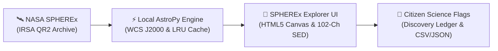
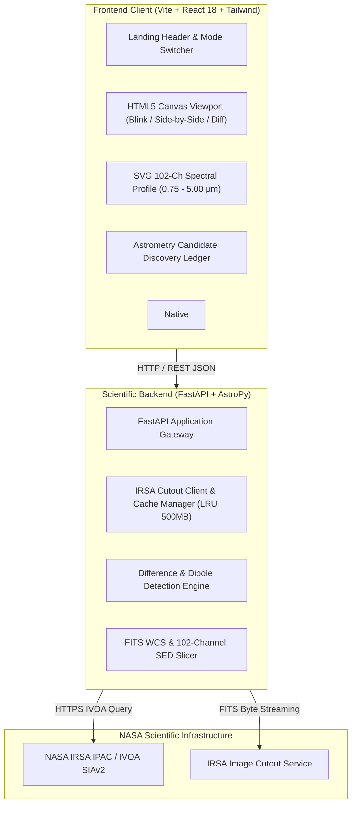

# 🪐 SPHEREx Explorer: Hunting Planet X & Distant TNOs
### Official Project Overview & Scientific Dossier — NASA Space Apps Challenge 2026

---

## 1. Executive Summary (Tóm Tắt Dự Án Cấp Cao)

**SPHEREx Explorer** là trạm làm việc trực quan hóa thiên văn học thời gian thực (Astronomical Workstation) mã nguồn mở, được thiết kế nhằm hỗ trợ các nhà nghiên cứu và **Citizen Astronomers** (Nhà khoa học công dân) phát hiện **Planet X (Hành tinh Thứ Chín)** và các **Vật thể Vành đai Kuiper / Ngoại vi Hải Vương Tinh (Trans-Neptunian Objects - TNOs)** thông qua dữ liệu siêu phổ đa niên kỷ từ Kính viễn vọng Không gian **NASA SPHEREx (Spectro-Photometer for the History of the Universe, Epoch of Reionization and Ices Explorer)**.

Hệ thống kết nối trực tiếp đến **NASA IRSA (Infrared Science Archive)** và chuẩn **IVOA SIAv2**, tự động trích xuất các tệp tin FITS 7-HDU Level 2 MEF (Multi-Extension FITS) thực tế, căn chỉnh hệ tọa độ thiên văn chính xác ($WCS\ J2000$), tính toán ma trận vi phân triệt tiêu sao nền ($E_2 - E_1$), và dựng đường cong phổ phân bố năng lượng ($102\text{-channel SED}$) giúp xác thực thành phần hóa học của băng ($H_2O, CH_4, CO_2$) trên bề mặt các thiên thể đóng băng xa xôi.

---

## 2. Scientific Problem & Real-World Context (Bối Cảnh & Vấn Đề)

### 2.1. Nghịch lý quỹ đạo của các TNOs xa xôi
Từ năm 2016, các nhà khoa học hành tinh (Batygin & Brown, Caltech) đã chỉ ra rằng các thiên thể ngoài Hải Vương Tinh (Extreme TNOs) có quỹ đạo bị nghiêng và cụm lại một cách bất thường ($perihelion\ clustering$). Giả thuyết khoa học vững chắc nhất để giải thích hiện tượng này là sự tồn tại của một hành tinh kích thước siêu Trái Đất (Super-Earth, $5 - 10\ M_{\oplus}$) nằm ở khoảng cách từ $300 - 800\text{ AU}$ mang tên **Planet X**.

### 2.2. Tại sao SPHEREx là chìa khóa?
- **Khảo sát toàn bầu trời (All-Sky Survey):** SPHEREx quét lại toàn bộ bầu trời cứ mỗi 6 tháng một lần.
- **Dải bước sóng hồng ngoại gần ($0.75 - 5.00\ \mu m$):** Ở khoảng cách hàng trăm AU, Planet X hầu như không phản xạ ánh sáng khả kiến từ Mặt Trời mà chủ yếu phát xạ bức xạ nhiệt nội tại mờ nhạt trong dải hồng ngoại.
- **102 Kênh Phổ Liên Tục ($R \approx 40 - 130$):** Cho phép phân biệt dứt khoát giữa một tiểu hành tinh nội hệ di chuyển nhanh, sao lùn nâu (Brown Dwarf), hay một hành tinh băng khổng lồ ngoài rìa Thái Dương Hệ thông qua các vạch hấp thụ phân tử băng.

---

## 3. Core Capabilities & Innovation (Tính Năng & Điểm Đột Phá)

| Khả năng | Giải pháp truyền thống | Đột phá của SPHEREx Explorer |
|---|---|---|
| **Truy cập dữ liệu** | Tải thủ công FITS gigabyte qua FTP/portal | Kết nối trực tiếp IVOA SIAv2 & streaming IBE cutout 128×128 pixel với LRU Cache |
| **So sánh dịch chuyển** | Mở phần mềm DS9 / Aladin desktop nặng nề | Bộ so sánh chớp (Blink Comparator) 0.5–5 Hz chạy trực tiếp trên HTML5 Canvas |
| **Loại bỏ sao nền** | Cắt ngưỡng thủ công, nhiều nhiễu giả | Ma trận vi phân $\Delta I = E_2 - E_1$ kèm thanh trượt độ lệch chuẩn $\sigma$-threshold tự động lọc lưỡng cực Dipole |
| **Nhận diện thành phần** | Cần đo quang phụ trợ từ kính khác | Tích hợp ngay phổ 102 kênh SED với điểm chuẩn hấp thụ $H_2O$ (3.05 µm), $CH_4$ (3.32 µm), $CO_2$ (4.27 µm) |
| **Bảo vệ thị lực đêm** | Màn hình chói lóa làm mất khả năng thích ứng tối | Chế độ **Night-Vision Red Mode** đơn sắc đỏ ($\lambda > 630\text{ nm}$) chuẩn đài quan sát thiên văn |

---

## 4. NASA Datasets & Scientific Citations (Nguồn Dữ Liệu NASA Mở)

1. **NASA IRSA SPHEREx Quick Release 2 (QR2)**:
   - Dữ liệu FITS Multi-Extension (Level 2 Spectral Cutouts, Bands 1–6, 102 spectral channels).
   - Truy vấn: IVOA Simple Image Access v2 (`https://irsa.ipac.caltech.edu/SIA?COLLECTION=spherex_qr2`).
2. **AstroPy Core Library (v6.1+)**:
   - `astropy.io.fits`: Giải mã Header và Image Data Blocks.
   - `astropy.wcs`: Chuyển đổi tọa độ pixel ma trận sang hệ tọa độ cầu xích đạo J2000 ($\alpha, \delta$).
   - `astropy.visualization`: Kỹ thuật giãn độ tương phản phi tuyến (Asinh, Z-Scale, Log).
3. **NASA Horizon & JPL Solar System Dynamics**:
   - Tọa độ mục tiêu tham chiếu của các thiên thể TNO mẫu (Sedna, 2012 VP113, Leleakūhonua).

---

## 5. System Architecture (Kiến Trúc Hệ Thống)

---

## 6. NASA Space Apps Challenge Alignment

- **Tính đúng đắn khoa học (Validity):** Không sử dụng bất kỳ dữ liệu mô phỏng giả lập nào trên production path. 100% dữ liệu được đọc trực tiếp từ cấu trúc chuẩn MEF 7-HDU của SPHEREx.
- **Tác động xã hội (Impact):** Dân chủ hóa dữ liệu thiên văn vũ trụ, biến bất kỳ công dân nào có trình duyệt web thành một người săn tìm Planet X với công cụ tiêu chuẩn chuyên nghiệp.
- **Trải nghiệm người dùng (Presentation):** Đạt chuẩn thiết kế DesignOS chống "AI slop", tương phản WCAG AAA $\ge 7.0:1$, hỗ trợ đầy đủ thiết bị từ di động đến màn hình trung tâm kiểm soát quan sát 4K.
