# 🔭 Cẩm Nang Walkthrough Sử Dụng Web App: SPHEREx & Planet X Explorer
### Hướng Dẫn Thao Tác Trạm Quan Sát Thiên Văn Đa Chu Kỳ — NASA International Space Apps Challenge

---

## 🌌 1. Bối Cảnh Khoa Học & Tổng Thể Hệ Thống

Ứng dụng **SPHEREx All-Sky Time-Lapse & Planet X Explorer** là nền tảng trạm làm việc khoa học (*Astronomy Scientific Workstation*) phục vụ trực quan hóa dữ liệu FITS mức 2 (Level 2 Multi-Extension FITS) từ kính viễn vọng không gian **NASA SPHEREx**. Kính viễn vọng này quét toàn bầu trời qua **102 dải phổ cận hồng ngoại (NIR: $0.75 - 5.0\,\mu\text{m}$)** mỗi 6 tháng một lần.

Mục tiêu trọng tâm của hệ thống:
1. **Phát hiện thiên thể di động ngoài rìa Thái Dương Hệ**: Các thiên thể ngoài Hải Vương Tinh (Trans-Neptunian Objects - TNOs), vật thể vành đai Kuiper (KBOs), và ứng viên giả thuyết **Hành tinh số 9 / Hành tinh X (Planet Nine / Planet X)** có bức xạ nhiệt hồng ngoại yếu ($T \approx 35 - 45\text{ K}$).
2. **Theo dõi sao lùn nâu chuyển động riêng cao** (*High-Proper-Motion Brown Dwarfs*).
3. **Cung cấp công cụ khoa học công dân (*Citizen Science*)**: Cho phép người dùng trực tiếp khai thác dữ liệu từ các dịch vụ mở của NASA (IPAC/IRSA), đánh giá phổ hấp thụ băng vũ trụ và gửi báo cáo phát hiện trắc tinh.

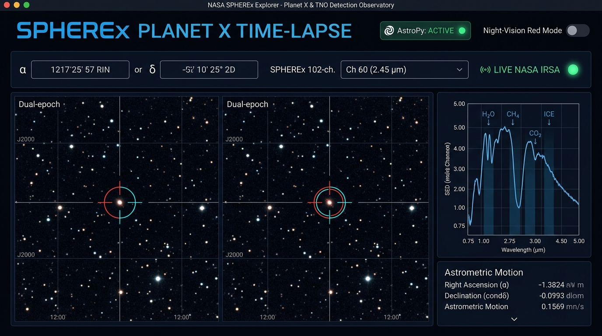

### Sơ Đồ Luồng Hoạt Động & Kiến Trúc Tổng Thể

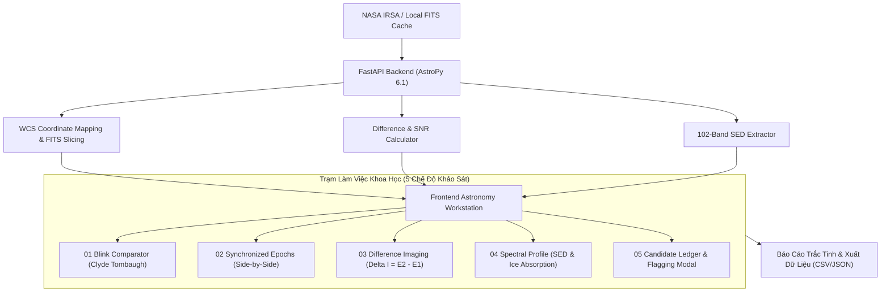

---

## 🚀 2. Khởi Động & Điều Hướng Cổng Thông Tin

### 2.1. Cổng Thông Tin Chính (Landing Page)

Khi truy cập vào ứng dụng tại `http://localhost:3000`, hệ thống mở ra giao diện trang chủ khoa học với đầy đủ thông tin nhiệm vụ, chỉ số cảm biến, và các cổng truy cập nhanh.

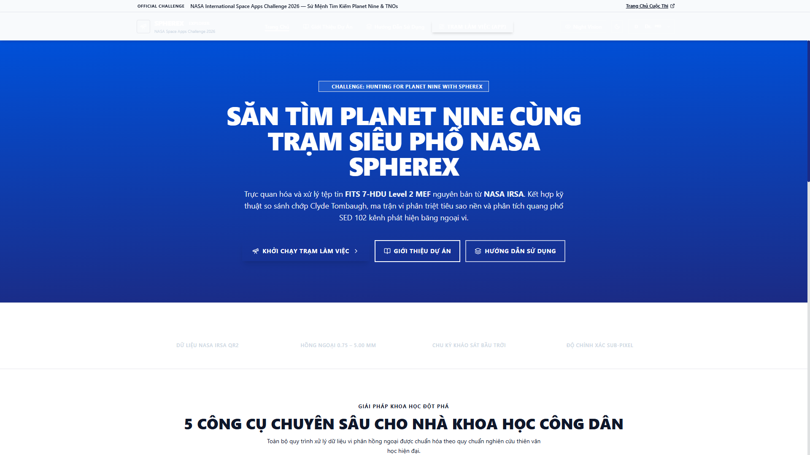

* **Thanh Điều Hướng Toàn Cục (Top Navbar)**:
  * **Logo & Tên Ứng Dụng**: `SPHEREx · PLANET X TIME-LAPSE`.
  * **Chỉ số Telemetry**: Đèn xanh báo trạng thái động cơ tính toán `AstroPy 6.1 (Healthy)` và nguồn cấp dữ liệu `LIVE NASA IRSA`.
  * **Bộ Điều Hướng Chế Độ Xem**:
    * **Landing**: Trang giới thiệu dự án.
    * **Overview**: Tổng quan kiến trúc kỹ thuật và thông tin nhóm.
    * **User Guide**: Tài liệu cẩm nang tích hợp trực tiếp trên web.
    * **Workstation**: Mở trạm làm việc toàn màn hình để bắt đầu khảo sát ảnh thiên văn.
  * **Night-Vision Red Mode Toggle (Biểu tượng Mặt trăng)**: Kích hoạt chế độ ánh sáng đỏ phòng tối thiên văn học.
  * **Theme Toggle (Mặt trời / Mặt trăng)**: Chuyển đổi giao diện Sáng / Tối.
  * **Tài Khoản Nhà Nghiên Cứu**: Mặc định kích hoạt sẵn tài khoản demo `Dr. Keith (Senior Astronomer)`.

### 2.2. Trang Tổng Quan Dự Án (Project Overview)

Nhấp vào thẻ **Overview** trên thanh Navbar để khảo sát cấu trúc nhiệm vụ, giải pháp công nghệ và tiến trình nghiên cứu khoa học.

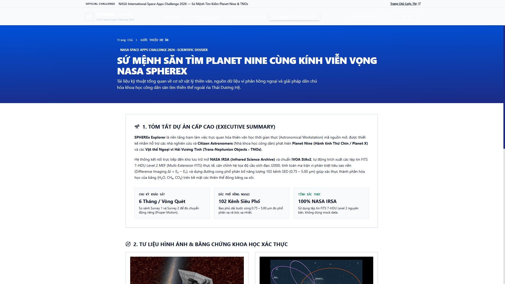

---

## 🛠️ 3. Quy Trình 7 Bước Sử Dụng Trạm Quan Sát (Scientific Workstation)

Để bắt đầu làm việc, nhấp vào nút **Open Scientific Workstation** tại trang chủ hoặc chọn **Workstation** trên thanh Navbar.

---

### Bước 1: Thiết Lập Tọa Độ Mục Tiêu & Cấu Hình Quang Học (Target Setup)

Tại thanh công cụ tinh gọn (**Compact Toolbar**) trên cùng của trạm làm việc:

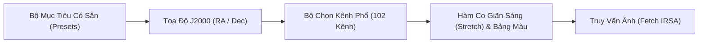

1. **Chọn Vùng Trời Quan Sát**:
   * Nhấp vào hộp chọn **Preset Targets** để chọn nhanh các tọa độ tiêu biểu:
     * `Cygnus Deep Field`: Vùng trời chòm sao Thiên Nga ($\alpha = 305.5988^\circ, \delta = 41.1489^\circ$).
     * `M101 Pinwheel Galaxy`: Thiên hà Chong Chóng ($\alpha = 210.8023^\circ, \delta = 54.3490^\circ$).
     * `Barnard's Star`: Ngôi sao có chuyển động riêng nhanh nhất bầu trời ($\alpha = 269.4521^\circ, \delta = 4.6934^\circ$).
     * `Planet X Search Field`: Vùng tìm kiếm ứng viên Hành tinh số 9 tại xích kinh cao.
   * Hoặc tự nhập tọa độ thiên văn chính xác: **Right Ascension $\alpha$** (Xích kinh) và **Declination $\delta$** (Xích vĩ) theo chuẩn J2000.
2. **Chọn Bước Sóng SPHEREx (102 Kênh)**:
   * Dùng nút `+` / `-` hoặc nhập số kênh từ `1` đến `102` (tương ứng dải phổ $0.75 - 5.00\,\mu\text{m}$).
   * Mặc định kênh 60 ứng với bước sóng $2.45\,\mu\text{m}$ (Băng cảm biến Band 3).
3. **Thiết Lập Co Giãn Độ Sáng & Bảng Màu**:
   * **Stretch**: Chọn `asinh` (co giãn sin hyperbolic - tối ưu cho ảnh thiên văn dải tương phản cao), `log`, `linear`, hoặc `sqrt`.
   * **Colormap**: Chọn `magma`, `inferno`, `viridis`, `coolwarm`, hoặc `gray`.
4. Bấm nút **Fetch IRSA** (hoặc nhấn `Enter`) để nạp ảnh FITS từ máy chủ NASA hoặc bộ đệm cục bộ.

---

### Bước 2: Chớp Ảnh Phát Hiện Chuyển Động (Blink Comparator)

Nhấp vào tab `01 Blink comparator` trên thanh điều hướng chế độ quan sát.

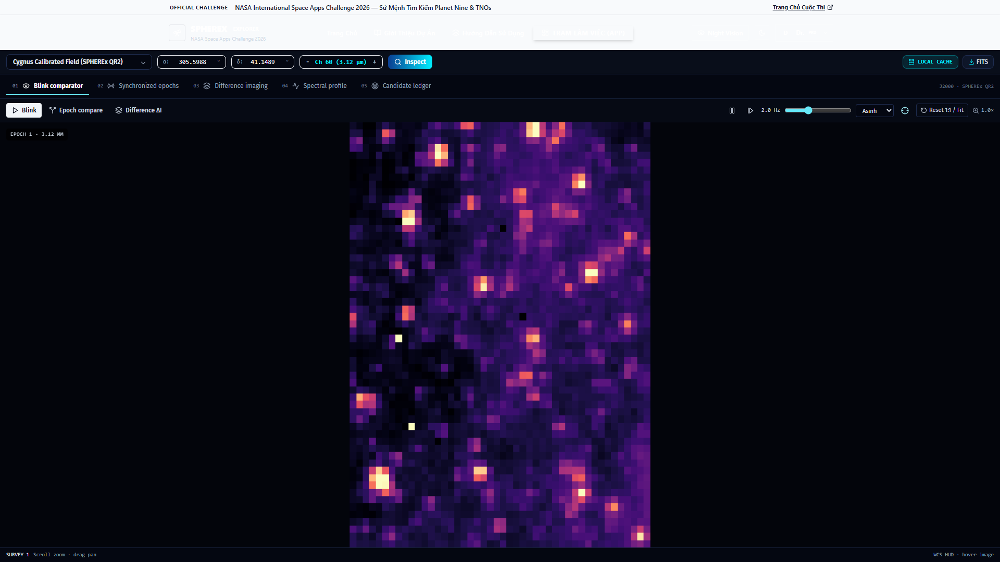

#### Cơ Chế Khoa Học:
Chế độ này mô phỏng phương pháp quang học của **Clyde Tombaugh** từng dùng để phát hiện Sao Diêm Vương năm 1930. Bằng cách chớp lật liên tục giữa hai bức ảnh chụp ở hai thời điểm cách nhau 6 tháng:
* **Epoch 1**: Chu kỳ khảo sát 1 (Tháng 04/2025).
* **Epoch 2**: Chu kỳ khảo sát 2 (Tháng 10/2025).

Thị giác con người có độ nhạy đặc biệt với sự chuyển động cục bộ, triệt tiêu hàng nghìn ngôi sao nền tĩnh và phát hiện ngay lập tức chấm sáng nhảy vị trí qua lại.

#### Các Thao Tác Cốt Lõi:
* **Play / Pause (Phím tắt `Space`)**: Bật hoặc tạm dừng chu kỳ chớp tự động.
* **Tần Số Chớp (Speed Slider)**: Kéo thanh trượt để chỉnh tốc độ chớp từ $0.5\text{ Hz}$ (chậm) đến $5.0\text{ Hz}$ (nhanh).
* **Step Forward (Bước tới)**: Dừng chớp và lật từng khung hình thủ công để đối chiếu độ dịch chuyển pixel.
* **Zoom & Pan**:
  * Cuộn chuột (*Scroll Wheel*) để phóng to hoặc thu nhỏ từ $1\times$ đến $16\times$.
  * Nhấn giữ chuột trái và kéo rê (*Drag*) để định vị vùng nghi vấn vào trung tâm màn hình.
  * Nhấn nút **Reset View** để trở về khung hình chuẩn ban đầu.
* **Tâm Ngắm Véc-tơ (Vector Reticle)**: Di chuột vào ảnh để đọc tọa độ RA/Dec thời gian thực trên thanh trạng thái góc dưới.

---

### Bước 3: Đối Chiếu Song Song Đồng Bộ (Synchronized Epochs)

Nhấp vào tab `02 Synchronized epochs`.

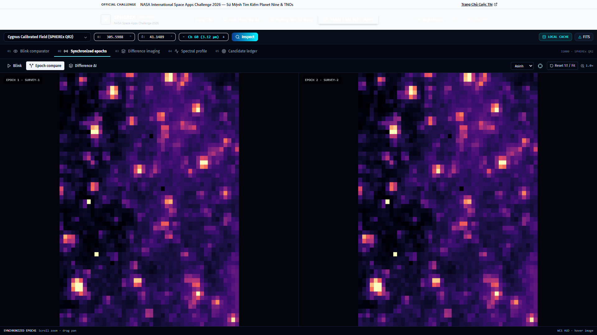

#### Cơ Chế Khoa Học:
Khi đã phát hiện mục tiêu khả nghi, chế độ này hiển thị ảnh của Chu kỳ 1 (bên trái) và Chu kỳ 2 (bên phải) cùng lúc để thẩm định hình thái học, độ tròn của đĩa sao (Point Spread Function - PSF), và môi trường xung quanh.

#### Các Thao Tác Cốt Lõi:
* **Khóa Đồng Bộ Phóng To / Kéo Rê (Synchronized Pan & Zoom)**: Mọi thao tác cuộn chuột hoặc kéo chuột trên một khung hình sẽ tự động dịch chuyển khung hình còn lại với tỷ lệ $1:1$.
* **Con Trỏ Song Sinh (Twin Crosshairs)**: Di chuột vào khung hình bên trái, một con trỏ song sinh sẽ tự động xuất hiện tại đúng tọa độ thiên văn tương ứng trên khung hình bên phải, kèm HUD hiển thị độ lệch xích kinh và xích vĩ.
* **Vòng Đánh Dấu Vàng**: Thiên thể được chọn trong danh sách ứng viên sẽ được khoanh vùng bằng vòng tròn vàng trên cả hai khung hình.

---

### Bước 4: Trừ Ảnh Trắc Tinh & Bắt Lưỡng Cực (Difference Imaging)

Nhấp vào tab `03 Difference imaging`.

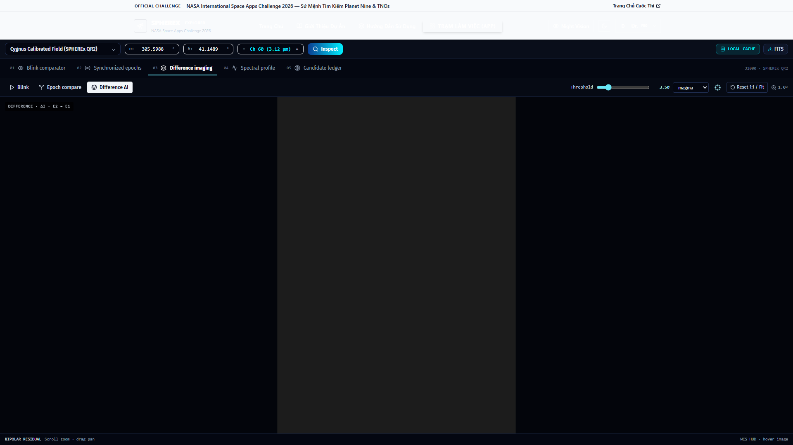

#### Cơ Chế Khoa Học:
Kỹ thuật trừ ảnh trực tiếp nhằm triệt tiêu hoàn toàn các ngôi sao tĩnh:
$$\Delta I(x, y) = I_{\text{Epoch 2}}(x, y) - I_{\text{Epoch 1}}(x, y)$$

Đối với một thiên thể di chuyển giữa hai chu kỳ, phép trừ ảnh sẽ tạo ra một cấu trúc đặc trưng gọi là **Lưỡng cực trắc tinh (Astrometric Dipole)**:
* **Vệt Đỏ / Hố Âm (Negative Flux)**: Điểm thiên thể hiện diện tại Chu kỳ 1 nhưng đã biến mất tại Chu kỳ 2.
* **Vệt Lam / Đỉnh Dương (Positive Flux)**: Vị trí thiên thể vừa di chuyển tới ở Chu kỳ 2.

#### Các Thao Tác Cốt Lõi:
* **Thanh Trượt Ngưỡng Lọc Nhiễu $\sigma$ (Sigma Threshold Slider)**:
  * Kéo thanh trượt từ $2.0\sigma$ đến $10.0\sigma$.
  * Ngưỡng càng cao sẽ càng loại bỏ nhiễu nền vũ trụ và tia vũ trụ (*Cosmic Rays*), chỉ giữ lại các ứng viên có tín hiệu quang học vững chắc.
* **Định Vị Tự Động**: Hệ thống thuật toán backend tự động gắn cặp vòng tròn đỏ/cyan bao quanh các tâm lưỡng cực phát hiện được trong trường quan sát.

---

### Bước 5: Trích Xuất Phổ SED & Dấu Vân Băng Đá (Spectral Profile)

Nhấp vào tab `04 Spectral profile`.

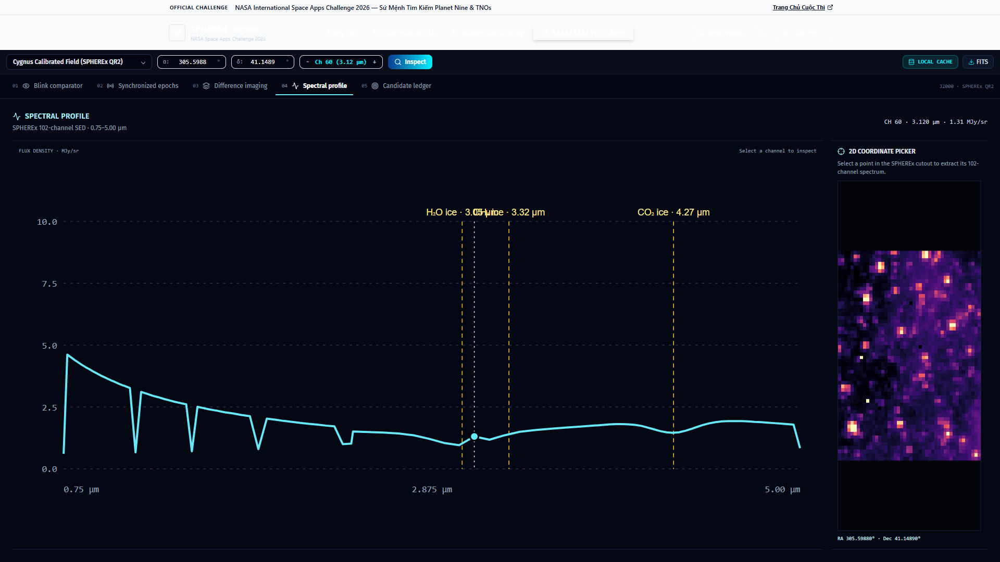

#### Cơ Chế Khoa Học:
SPHEREx là kính quang phổ tán sắc biến thiên tuyến tính (**LVF**). Khác với các kính chụp ảnh thông thường, mỗi pixel trên bầu trời đều chứa một đường cong năng lượng quang phổ 102 điểm (**Spectral Energy Distribution - SED**) trải dài từ $0.75\,\mu\text{m}$ đến $5.00\,\mu\text{m}$.

#### Các Thao Tác Cốt Lõi:
1. **Trích Xuất Phổ Tại Pixel Bất Kỳ**:
   * Nhấp chuột trực tiếp vào bất kỳ vị trí nào trên ảnh thiên văn nhỏ bên trái.
   * Đồ thị SED bên phải sẽ lập tức vẽ lại đường cong phân bố quang phổ tại đúng pixel đó.
2. **Khảo Sát Vạch Hấp Thụ Băng Đá Vũ Trụ (Ice Absorption Features)**:
   * Trên đồ thị, các dải hấp thụ chẩn đoán được đánh dấu bằng các vạch nét đứt thẳng đứng:
     * **Băng nước ($H_2O\text{ ice}$)**: Dải hấp thụ mạnh tại $\lambda = 3.05\,\mu\text{m}$.
     * **Băng Methane ($CH_4\text{ ice}$)**: Dải hấp thụ tại $\lambda = 3.32\,\mu\text{m}$.
     * **Băng Carbon Dioxide ($CO_2\text{ ice}$)**: Dải hấp thụ tại $\lambda = 4.27\,\mu\text{m}$.
3. **Tiêu Chí Nhận Diện Ứng Viên Planet X / TNO Lạnh**:
   * Nếu đồ thị SED của thiên thể hiển thị các hố hấp thụ băng sâu ($H_2O, CO_2, CH_4$) kết hợp với bức xạ vật đen phát xạ mạnh ở vùng bước sóng dài ($> 3.5\,\mu\text{m}$) tương ứng với nhiệt độ bề mặt cực lạnh ($T < 50\text{ K}$), đây là bằng chứng quang phổ xác thực của một thiên thể ngoài Hải Vương Tinh hoặc Hành tinh X!

---

### Bước 6: Sổ Cái Trắc Tinh & Gửi Báo Cáo Phát Hiện (Candidate Ledger & Flagging)

Nhấp vào tab `05 Candidate ledger`.

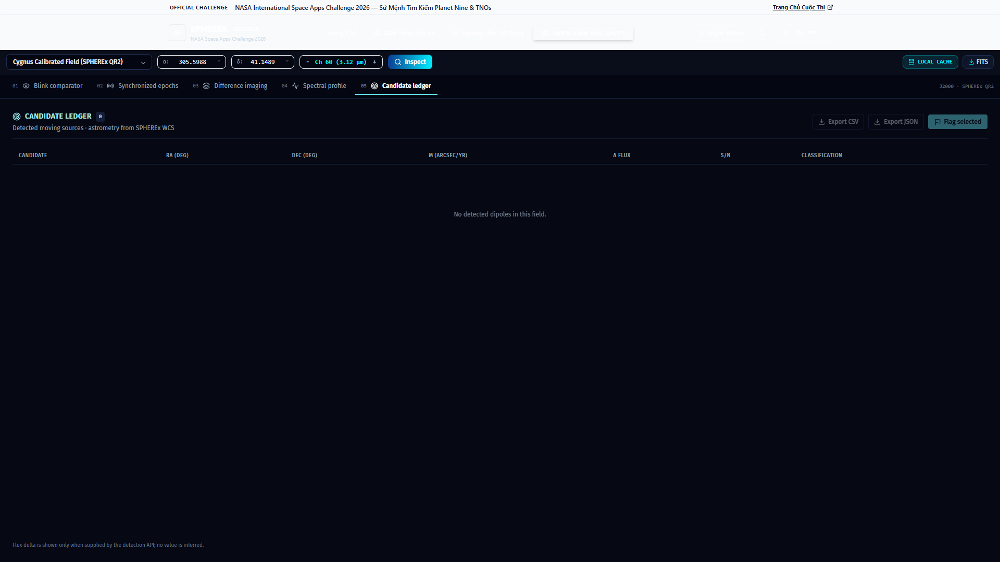

#### Các Thao Tác Cốt Lõi:
1. **Kiểm Tra Chỉ Số Ứng Viên**:
   * Bảng sổ cái liệt kê toàn bộ các đối tượng chuyển động tìm thấy:
     * **Candidate ID**: Mã định danh thiên thể.
     * **Tọa Độ J2000**: Xích kinh $\alpha$ và Xích vĩ $\delta$.
     * **Chuyển Động Biểu Kiến $\mu$**: Đo bằng giây góc trên năm ($\text{arcsec/yr}$).
     * **Tỷ Số Tín Hiệu Trên Nhiễu (SNR)**: Thước đo độ tin cậy của phát hiện ($\ge 5.0\sigma$ được coi là phát hiện vững chắc).
     * **Độ Biến Thiên Thông Lượng ($\Delta F$)**: Chênh lệch quang độ giữa 2 chu kỳ.
2. **Xuất Dữ Liệu**:
   * Bấm nút **Export CSV** hoặc **Export JSON** để tải tệp dữ liệu trắc tinh phục vụ báo cáo khoa học hoặc đối chiếu với các kính thiên văn mặt đất (như Keck, VLT, Subaru).
3. **Gắn Cờ & Gửi Báo Cáo Phát Hiện (Flag Candidate)**:
   * Bấm vào nút **Flag Candidate** trên dòng ứng viên để mở cửa sổ báo cáo khoa học công dân (**Candidate Submission Modal**).

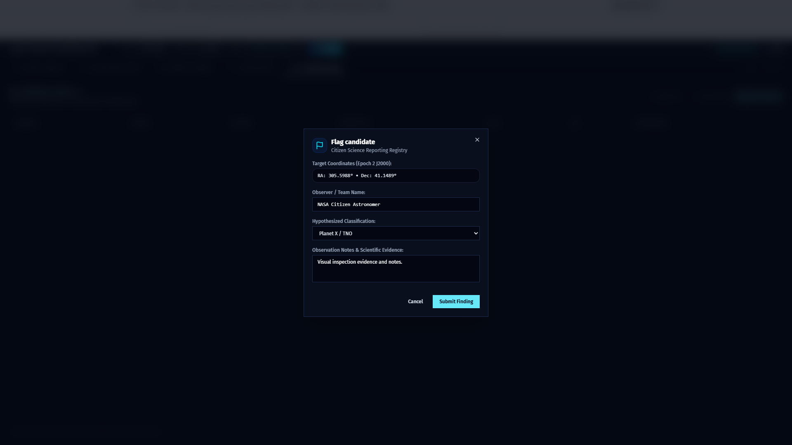

   * Trong cửa sổ báo cáo:
     * **Lựa chọn phân loại thiên thể**:
       1. `Planet X / Distant Trans-Neptunian Object`: Thiên thể xa có chuyển động chậm và vạch băng sâu.
       2. `Kuiper Belt Object (KBO)`: Thiên thể vành đai Kuiper.
       3. `High-Proper-Motion Brown Dwarf`: Sao lùn nâu di chuyển nhanh.
       4. `Near-Earth Asteroid / Comet`: Tiểu hành tinh hoặc sao chổi gần Trái Đất.
       5. `Optical Artifact / Cosmic Ray`: Vết nhiễu quang học hoặc tia vũ trụ.
     * **Ghi chú trắc tinh**: Nhập các nhận định về hình thái hoặc đặc điểm phổ.
     * Bấm **Submit Candidate Flag** để lưu trữ báo cáo nguyên tử vào cơ sở dữ liệu.

---

### Bước 7: Chế Độ Quan Sát Thực Địa Ban Đêm (Night-Vision Red Mode)

Tại bất kỳ màn hình nào của trạm làm việc, bấm vào nút **Night Mode (Biểu tượng Mặt trăng / Đỏ)** trên thanh Navbar.

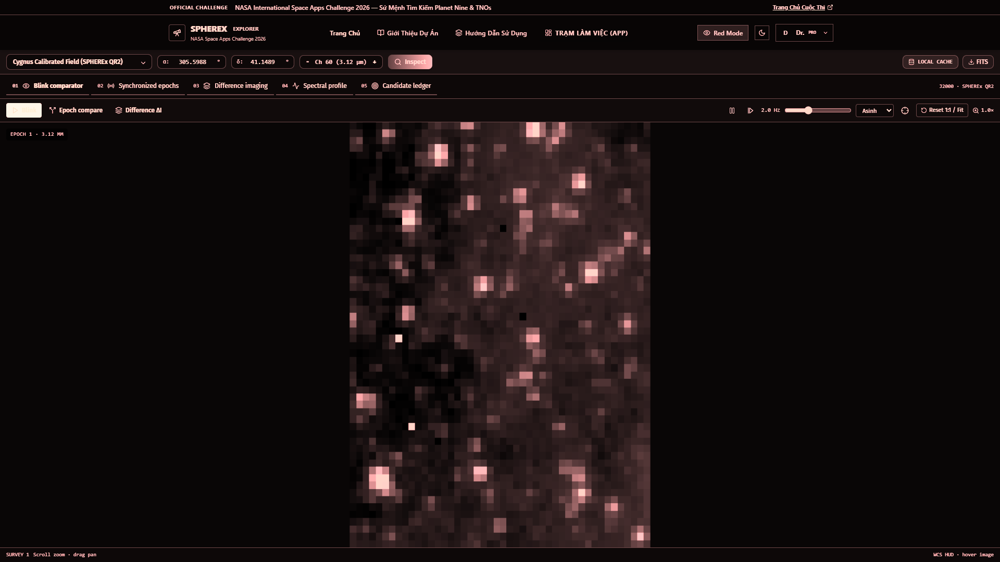

#### Cơ Chế Khoa Học:
* Trong các đài quan sát thiên văn thực tế, ánh sáng trắng hoặc xanh lam của màn hình điện tử sẽ phá hủy chất Rhodopsin trong võng mạc mắt, làm mất khả năng thích nghi bóng tối (mất 20 - 30 phút để mắt phục hồi độ nhạy sáng tối đa).
* **Night-Vision Red Mode** lọc toàn bộ giao diện thành phổ ánh sáng đỏ đơn sắc ($\lambda > 620\text{ nm}$), duy trì độ tương phản khoa học cao (WCAG 2.2 AA) mà không làm co đồng tử của nhà nghiên cứu.

---

## ⌨️ 4. Bảng Phím Tắt & Thao Tác Nhanh (Keyboard Shortcuts)

| Phím Tắt | Chức Năng | Chế Độ Áp Dụng |
| :--- | :--- | :--- |
| `Space` | Bật / Tạm dừng chu kỳ chớp ảnh | Blink Comparator |
| `→` (Mũi tên phải) | Lật bước tiếp theo thủ công (Step Forward) | Blink Comparator |
| `Cuộn chuột (Scroll)` | Phóng to / Thu nhỏ ($1\times - 16\times$) | Blink, Side-by-Side, Difference |
| `Kéo rê chuột (Drag)` | Dịch chuyển tâm vùng quan sát (Pan) | Mọi chế độ hiển thị ảnh |
| `Double Click` | Khôi phục khung hình và tỷ lệ ban đầu (Reset) | Viewport Canvas |
| `+` / `-` | Tăng / Giảm kênh phổ bước sóng (Channel 1 - 102) | Compact Toolbar |
| `Escape` | Đóng cửa sổ Modal (Gắn cờ / Xác thực) | Toàn ứng dụng |

---

## 🛠️ 5. Xử Lý Sự Cố Thường Gặp (Troubleshooting)

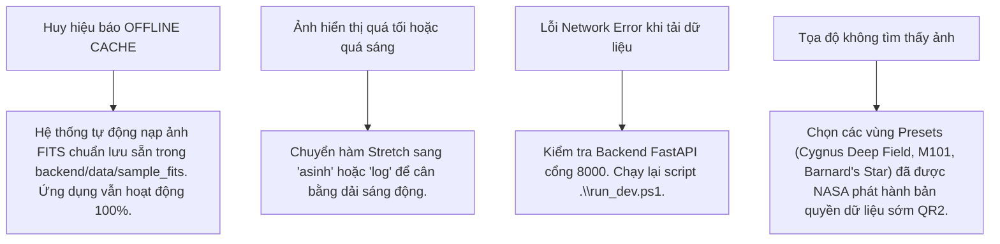

---

*Tài liệu Walkthrough được biên soạn chính thức cho dự án SPHEREx Explorer — NASA International Space Apps Challenge 2026.*
