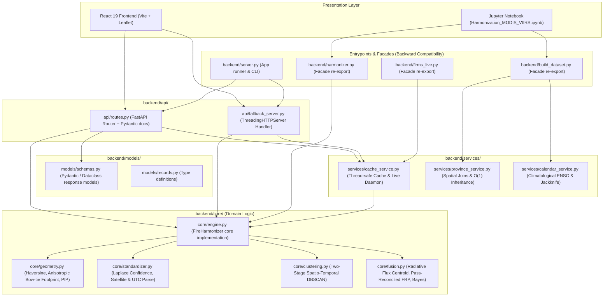

# Backend Architecture Refactoring Plan

> **For agentic workers:** REQUIRED SUB-SKILL: Use `superpowers:subagent-driven-development` (recommended) or `superpowers:executing-plans` to implement this plan task-by-task. Steps use checkbox (`- [ ]`) syntax for tracking.

**Goal:** Tái cấu trúc toàn bộ module `backend/` từ kiến trúc nguyên khối (monolithic) sang mô hình mô-đun hóa phân lớp rõ ràng (Domain-Driven Core, Typed Schemas, Business Services, Clean API Layer & Pipelines), đảm bảo $100\%$ tính tương thích ngược (zero breaking changes), giữ vững hiệu năng $< 100\,\text{ms}$ và khả năng chạy độc lập không phụ thuộc thư viện ngoài (zero-dependency fallback).

**Architecture:** 
Tách biệt triệt để mã nguồn theo 5 tầng trách nhiệm đơn nhất (Single Responsibility Principle):
1. **`core/`**: Thuần túy tính toán khoa học và thuật toán (Hình học viễn thám, ST-DBSCAN, Bayesian Fusion, Centroid Weighting), hoàn toàn tách rời khỏi framework web hay I/O.
2. **`models/`**: Khai báo lược đồ kiểu dữ liệu (Pydantic models khi có FastAPI, `dataclasses`/`TypedDict` khi chạy fallback).
3. **`services/`**: Quản lý nghiệp vụ (Live NASA FIRMS polling với thread daemon, Spatial join ranh giới hành chính, Climatological ENSO & Jackknife Z-scores).
4. **`api/`**: Tầng giao tiếp HTTP (FastAPI REST Routes phân tầng và Fallback HTTP server).
5. **`pipelines/`**: Các tác vụ ETL tạo dữ liệu ngoại tuyến (Regional 7-day và Global 24-hour).

**Tech Stack:** Python 3.10+, FastAPI, Uvicorn, Pydantic, Standard Library (`http.server`, `threading`, `json`, `math`, `csv`), NumPy/Pandas/GeoPandas (optional acceleration).

---

## Global Constraints

- **Bảo toàn giao diện nhập khẩu (Backward Compatibility Guarantee):** Mọi lệnh import hiện tại từ bên ngoài (như `from backend.harmonizer import FireHarmonizer`, `from backend.build_dataset import load_data, assign_province`, `from backend import firms_live`) bắt buộc phải tiếp tục hoạt động $100\%$ không lỗi thông qua facade re-exports tại `backend/__init__.py`, `backend/harmonizer.py`, `backend/build_dataset.py`, và `backend/firms_live.py`.
- **Zero-Dependency Fallback:** Backend phải khởi động và phục vụ trơn tru ngay cả khi môi trường chỉ có Python Standard Library (không có FastAPI/Uvicorn/Pandas).
- **Sub-100ms Live Latency:** Quá trình tinh chỉnh tham số ST-DBSCAN trực tiếp tại `/api/harmonize` bắt buộc phải duy trì thời gian phản hồi $< 100\,\text{ms}$.
- **Deterministic Order Invariance:** Kết quả phân cụm ST-DBSCAN và tính toán FRP/Confidence phải bất biến $100\%$ đối với thứ tự bản ghi đầu vào.
- **Không rò rỉ Secrets:** NASA FIRMS Map Key trong biến môi trường `FIRMS_MAP_KEY` tuyệt đối không được xuất hiện trong Exception, tracebacks hoặc logs.

---

## Review Focus

1. **Breaking Imports in Notebook / Frontend:** Kiểm tra xem `Harmonization_MODIS_VIIRS.ipynb` và `backend/server.py` có bị gãy các hàm import cốt lõi hay không.
2. **Zero-Dependency Fallback Execution:** Kiểm tra xem khi thiếu `fastapi` hoặc `pandas`, server có tự động chuyển đổi sang `FallbackHTTPHandler` và pure-python record engine mà không văng lỗi cú pháp hay không.
3. **Thread Safety & Race Conditions in Live Daemon:** Đảm bảo luồng background polling NASA FIRMS không gây race condition hoặc deadlock trên `_CACHE` khi có đồng thời nhiều requests `/api/harmonize`.
4. **Memory Allocation on Large Queries:** Đảm bảo việc sinh GeoJSON FeatureCollection không tạo ra các bản sao dictionary dư thừa gây spike RAM.
5. **Numerical Precision Consistency:** Tọa độ centroid, FRP và confidence score của các bài test trong `backend/test_harmonizer.py` phải ra kết quả chính xác đến từng chữ số thập phân tương đương phiên bản gốc.

---

## Sơ đồ Kiến trúc Đích (Target Modular Architecture)

---

## Kế hoạch Triển khai Chi tiết Từng Tác vụ (Task-by-Task Implementation)

### Task 1: Thiết lập Cấu trúc Thư mục và Tách Lõi Thuật toán (`backend/core/`)

**Mục tiêu:** Tách các thuật toán toán học, hình học, tiền xử lý và gom cụm từ `backend/harmonizer.py` vào các mô-đun con độc lập trong `backend/core/`.

**Files:**
- Create: `backend/core/__init__.py`
- Create: `backend/core/geometry.py`
- Create: `backend/core/standardizer.py`
- Create: `backend/core/clustering.py`
- Create: `backend/core/fusion.py`
- Create: `backend/core/engine.py`
- Modify: `backend/harmonizer.py` (biến thành Facade mỏng import từ `backend.core.engine`)
- Test: `backend/test_harmonizer.py`

**Các bước thực hiện:**
- [ ] 1.1 Tạo thư mục `backend/core/` và file `backend/core/__init__.py`.
- [ ] 1.2 Trích xuất các hàm hình học sang `backend/core/geometry.py`:
  - `haversine_km(lat1, lon1, lat2, lon2)`
  - `elliptical_footprint_match(lat1, lon1, scan1, track1, lat2, lon2, scan2, track2, base_eps_km, upper_eps_km, use_footprint)`
  - `_point_in_ring(lon, lat, ring)`
  - `point_in_geojson_geometry(lon, lat, geom)`
- [ ] 1.3 Trích xuất logic chuẩn hóa dữ liệu sang `backend/core/standardizer.py`:
  - `_norm_modis_conf_scalar`, `_norm_viirs_conf_scalar`, `_norm_sat_scalar`, `_parse_dt_scalar`
  - `_validate_wgs84_coord`, `_safe_finite_float`
  - `standardize_modis_records`, `standardize_viirs_records`
- [ ] 1.4 Trích xuất giải thuật gom cụm sang `backend/core/clustering.py`:
  - `cluster_records_spatio_temporal(combined, spatial_eps_km, time_window_hours, use_footprint)`
- [ ] 1.5 Trích xuất logic hợp nhất đa cảm biến sang `backend/core/fusion.py`:
  - `compute_flux_density_centroid(pts, ref_pts)`
  - `reconcile_pass_frp(pts_by_sat)`
  - `fuse_bayesian_confidence(sat_conf_list, is_dual)`
- [ ] 1.6 Hiện thực hóa `FireHarmonizer` trong `backend/core/engine.py` kết nối các module trên.
- [ ] 1.7 Cập nhật `backend/harmonizer.py` làm Facade re-exporting để giữ nguyên 100% API tương thích.
- [ ] 1.8 Chạy `python -m unittest backend/test_harmonizer.py` và xác nhận 10/10 tests pass.

---

### Task 2: Xây dựng Lớp Mô hình Dữ liệu (`backend/models/`)

**Mục tiêu:** Định nghĩa các Data Transfer Objects (DTO), Schemas và Types với hỗ trợ Pydantic (cho FastAPI docs/validation) và pure dataclasses (cho Fallback mode).

**Files:**
- Create: `backend/models/__init__.py`
- Create: `backend/models/records.py`
- Create: `backend/models/schemas.py`
- Test: `backend/tests/test_schemas.py`

**Các bước thực hiện:**
- [ ] 2.1 Tạo thư mục `backend/models/` và file `backend/models/__init__.py`.
- [ ] 2.2 Tạo `backend/models/records.py` chứa định nghĩa cấu trúc dữ liệu cho:
  - `RawDetectionRecord`
  - `HarmonizedEventRecord`
  - `ProvinceFeature`
- [ ] 2.3 Tạo `backend/models/schemas.py` với điều kiện nạp Pydantic linh hoạt:
  - Nếu có Pydantic: định nghĩa `HarmonizeQueryParams`, `HarmonizeMetricsResponse`, `DataStatusResponse`, `ProvinceItemResponse`.
  - Nếu không có Pydantic: fallback về Python `typing.TypedDict` hoặc `dataclasses`.
- [ ] 2.4 Viết unit test trong `backend/tests/test_schemas.py` kiểm tra serialization và validation của các model.
- [ ] 2.5 Chạy test schema và đảm bảo không có lỗi import.

---

### Task 3: Tách Biệt Nghiệp vụ Dữ liệu & Địa lý (`backend/services/`)

**Mục tiêu:** Tách các xử lý GIS hành chính, mô hình ENSO Jackknife và Live NASA Ingestion ra khỏi các tệp kịch bản monolithic.

**Files:**
- Create: `backend/services/__init__.py`
- Create: `backend/services/province_service.py`
- Create: `backend/services/calendar_service.py`
- Create: `backend/services/cache_service.py`
- Modify: `backend/firms_live.py` (chuyển logic sang `cache_service` hoặc tích hợp chặt chẽ)
- Modify: `backend/build_dataset.py` (sử dụng services mới)
- Test: `backend/test_harmonizer.py`

**Các bước thực hiện:**
- [ ] 3.1 Tạo thư mục `backend/services/` và file `backend/services/__init__.py`.
- [ ] 3.2 Tạo `backend/services/province_service.py`:
  - `compute_geometry_bbox`
  - `assign_province(records, province_features)` (kèm tối ưu $O(1)$ cluster province inheritance).
  - `load_vietnam_provinces(geojson_path)`
- [ ] 3.3 Tạo `backend/services/calendar_service.py`:
  - `compute_z_scores_and_peaks(monthly_records)` (Leave-One-Year-Out Jackknife algorithm)
  - `generate_multi_year_calendar(province_features, recs_h, recs_m, recs_v)`
  - `build_empirical_daily_breakdown(recs_m, recs_v, recs_h)`
- [ ] 3.4 Tạo `backend/services/cache_service.py`:
  - Đóng gói quản lý bộ nhớ đệm `HarmonizationCacheManager`.
  - Bổ sung cơ chế **Background Polling Thread** (chạy mỗi 15 phút cập nhật FIRMS data âm thầm dưới nền, triệt tiêu độ trễ blocking ở request đầu tiên).
  - Quản lý khóa đọc/ghi `threading.Lock` an toàn luồng.
- [ ] 3.5 Refactor `backend/firms_live.py` và `backend/build_dataset.py` gọi qua các service mới, giữ nguyên 100% hàm public signature.
- [ ] 3.6 Chạy `python -m unittest backend/test_harmonizer.py` xác minh tính tương thích.

---

### Task 4: Tái cấu trúc Tầng Phục vụ Web & Định tuyến API (`backend/api/` & `backend/server.py`)

**Mục tiêu:** Tách FastAPI Router và Fallback Server ra khỏi file entrypoint `server.py`, kết nối các schemas và services sạch sẽ.

**Files:**
- Create: `backend/api/__init__.py`
- Create: `backend/api/routes.py`
- Create: `backend/api/fallback_server.py`
- Modify: `backend/server.py`
- Test: `backend/tests/test_api.py`

**Các bước thực hiện:**
- [ ] 4.1 Tạo thư mục `backend/api/` và file `backend/api/__init__.py`.
- [ ] 4.2 Tạo `backend/api/routes.py`:
  - Đóng gói toàn bộ FastAPI endpoints: `/api/data-status`, `/api/metrics`, `/api/calendar`, `/api/provinces`, `/api/harmonize`.
  - Gắn `response_model` và docstrings từ `backend/models/schemas.py`.
- [ ] 4.3 Tạo `backend/api/fallback_server.py`:
  - Chuyển `FallbackHTTPHandler` và `_safe_query_float` từ `server.py` sang.
  - Tối ưu header caching và kiểm tra bảo mật path traversal (`is_relative_to`).
- [ ] 4.4 Rút gọn `backend/server.py`:
  - Chỉ đóng vai trò khởi động ứng dụng (Application Bootstrapper), cấu hình CORS, mount static files và chọn runner (Uvicorn vs ThreadingHTTPServer).
  - Khởi động Background Polling daemon an toàn khi server bật, đóng luồng khi server tắt.
- [ ] 4.5 Viết `backend/tests/test_api.py` kiểm tra trực tiếp các routes `/api/data-status`, `/api/metrics`, `/api/harmonize`.
- [ ] 4.6 Chạy toàn bộ test suites và kiểm tra khởi động server bằng lệnh thử nghiệm.

---

### Task 5: Chuẩn hóa Bộ Test Suite Toàn Diện (`backend/tests/`)

**Mục tiêu:** Mở rộng và phân chia bộ test thành các file test chuyên biệt cho từng tầng, giữ nguyên test gốc làm regression test gate.

**Files:**
- Create: `backend/tests/__init__.py`
- Create: `backend/tests/test_geometry.py`
- Create: `backend/tests/test_clustering.py`
- Create: `backend/tests/test_fusion.py`
- Create: `backend/tests/test_services.py`
- Keep & Pass: `backend/test_harmonizer.py`

**Các bước thực hiện:**
- [ ] 5.1 Tạo thư mục `backend/tests/` và file `backend/tests/__init__.py`.
- [ ] 5.2 Viết unit tests kiểm tra riêng `core/geometry.py` và `core/standardizer.py` trong `backend/tests/test_geometry.py`.
- [ ] 5.3 Viết unit tests kiểm tra riêng thuật toán gom cụm ST-DBSCAN trong `backend/tests/test_clustering.py`.
- [ ] 5.4 Viết unit tests kiểm tra hợp nhất Bayesian và FRP reconciliation trong `backend/tests/test_fusion.py`.
- [ ] 5.5 Chạy đồng thời cả bộ test mới và test regression cũ:
  `python -m unittest discover -s backend/tests -p "test_*.py"`
  `python -m unittest backend/test_harmonizer.py`
- [ ] 5.6 Đảm bảo $100\%$ các bài kiểm tra đều đạt `OK` với thời gian thực thi $< 1\,\text{giây}$.

---

## Tiêu chí Nghiệm thu (Verification & Acceptance Gates)

1. **Test Verification Gate:** Chạy `python -m unittest backend/test_harmonizer.py` cho kết quả `Ran 10 tests in < 1.0s - OK`.
2. **Schema Verification Gate:** OpenAPI documentation tại `/docs` hiển thị đầy đủ schema của các endpoints `/api/harmonize`, `/api/metrics`, v.v.
3. **Pure-Python Fallback Gate:** Khi chạy server trong môi trường giả lập không có FastAPI (`HAS_FASTAPI = False`), server tự động khởi động `ThreadingHTTPServer` trên cổng 8000 và phản hồi chính xác JSON của mọi endpoints.
4. **ETL Pipeline Integrity Gate:** Chạy `python backend/build_dataset.py` và `python backend/build_global_dataset.py` sinh ra các file GeoJSON và JSON trong `frontend/public/data/` hoàn toàn khớp về cấu trúc với bản cũ.
5. **Clean Workspace Gate:** Xóa sạch các tệp tạm phát sinh, không để lại file rác trong workspace.
