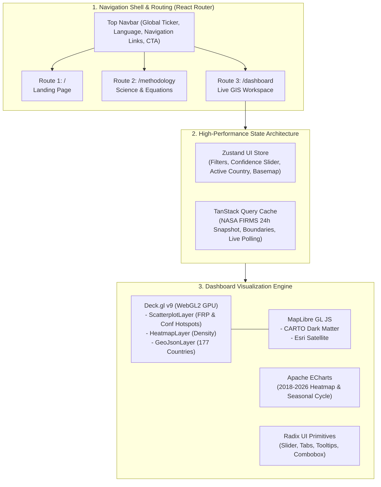

# Frontend Modernization & Multi-Route Architecture Plan

> **For agentic workers:** REQUIRED SUB-SKILL: Use `superpowers:subagent-driven-development` or `superpowers:executing-plans` to implement this plan task-by-task. Steps use checkbox (`- [ ]`) syntax for tracking.

**Goal:** Tái cấu trúc toàn diện hệ thống frontend từ ứng dụng đơn trang nguyên khối (monolithic single dashboard) thành nền tảng web viễn thám hiện đại chuẩn công nghiệp: phân tách 3 routes độc lập (Landing Page, Scientific Methodology, Live GIS Dashboard), nâng cấp engine bản đồ sang **Deck.gl v9 + MapLibre GL JS (kết xuất WebGL2 bằng GPU)**, trực quan hóa ma trận nhiệt bằng **Apache ECharts**, và quản lý dữ liệu hiệu năng cao với **Zustand + TanStack Query**.

---

## Architecture Overview

---

## User Review Required

> [!IMPORTANT]
> **Bộ thư viện mới được bổ sung vào dự án:**
> - `react-router-dom`: Định tuyến phân trang client-side mượt mà.
> - `@deck.gl/core`, `@deck.gl/react`, `@deck.gl/layers`, `@deck.gl/aggregation-layers`: Engine WebGL2 GPU cho phép vẽ và lọc hơn 100.000 điểm cháy ở 60 FPS.
> - `maplibre-gl` & `react-map-gl`: Bản đồ vector mã nguồn mở (0 token, 0 chi phí).
> - `echarts` & `echarts-for-react`: Kết xuất ma trận nhiệt đa năm và chu kỳ mùa 12 tháng chuyên nghiệp.
> - `zustand`: Quản lý bộ lọc và trạng thái UI phân vùng (slice selectors).
> - `@tanstack/react-query`: Quản lý bộ nhớ đệm dữ liệu viễn thám và tự động đồng bộ FIRMS.
> - `@radix-ui/react-slider`, `@radix-ui/react-tabs`, `@radix-ui/react-tooltip`: Primitives trợ năng WCAG 2.2 AA.

> [!NOTE]
> **Bảo toàn khả năng tương thích ngược (Zero Regression):**
> Bộ dữ liệu nén 87.311 điểm `fires_global_harmonized.json`, ranh giới 177 quốc gia `world_countries.geojson`, ma trận lịch `calendar_matrix.json` và API Python backend `/api/harmonize` giữ nguyên 100% cấu trúc hợp đồng dữ liệu.

---

## Proposed Changes

### Component 1: Dependencies & Core Infrastructure

- Bổ sung các thư viện hiện đại vào `frontend/package.json`.
- Thiết lập `QueryClientProvider` trong `src/main.tsx`.
- Tạo cấu trúc thư mục mới:
  - `src/pages/` (`LandingPage.tsx`, `MethodologyPage.tsx`, `DashboardPage.tsx`)
  - `src/stores/` (`useFilterStore.ts`, `useUiStore.ts`)
  - `src/components/deck/` (`FireDeckMap.tsx`, `layers/`)
  - `src/components/echarts/` (`FireRegimeHeatmap.tsx`)
  - `src/components/ui/` (Radix primitives styled with Tailwind)

---

### Component 2: State Management Layer (`src/stores/`)

#### [NEW] `src/stores/useFilterStore.ts`
- Quản lý trạng thái bộ lọc:
  - `minConfidence: number` (mặc định 80%)
  - `filterType: 'all' | 'dual' | 'high_frp'`
  - `selectedCountryId: number | null`
  - `selectedContinent: string`
  - `searchQuery: string`
  - `activeLayerMode: 'hotspots' | 'density' | 'both'`
  - `basemapStyle: 'dark' | 'satellite'`
- Sử dụng cơ chế selector để tránh re-render không cần thiết.

#### [NEW] `src/stores/useUiStore.ts`
- Quản lý ngôn ngữ (`lang: 'vi' | 'en'`) với đồng bộ `localStorage`.
- Quản lý điểm cháy đang chọn (`selectedPoint: GlobalHarmonizedPoint | null`).

---

### Component 3: Page Routing & Layout Shell

#### [MODIFY] `src/App.tsx`
- Cấu hình `BrowserRouter` với 3 tuyến đường:
  - `/`: `LandingPage`
  - `/methodology`: `MethodologyPage`
  - `/dashboard`: `DashboardPage`
- Cố định `Navbar` trên cùng hiển thị: Logo NASA FIRMS, navigation links có active indicator, global live ticker, chuyển ngữ và nút CTA "Khám Phá Bản Đồ".

#### [NEW] `src/pages/LandingPage.tsx`
- **Hero Section**: Nền gradient vũ trụ sâu thẳm, tiêu đề chuẩn viễn thám NASA, mô tả bài toán khử trùng lặp đa vệ tinh MODIS & VIIRS.
- **Live Telemetry Ticker**: 4 thẻ số liệu vĩ mô (87.311 quan sát toàn cầu, 953 xác thực kép, −43.3% khử trùng lặp, 143 quốc gia).
- **Core Pillars Section**: 3 khối kiến trúc khoa học (ST-DBSCAN Không-Thời Gian, Bayesian Sensor Fusion, Footprint Scaling 375m/1000m).
- **Interactive Teaser Widget**: Bản đồ xem trước mini WebGL trực quan hóa điểm nóng.
- **Call-To-Action (CTA)**: Nút "Khởi động Bàn Giám Sát Cháy Toàn Cầu" dẫn thẳng vào `/dashboard`.

#### [NEW] `src/pages/MethodologyPage.tsx`
- Chuyển đổi và mở rộng toàn bộ nội dung từ modal hiện tại thành trang tài liệu khoa học hoàn chỉnh.
- Định dạng công thức toán học tường minh (ST-DBSCAN, Bayesian Likelihood, Haversine Spatio-Temporal Metrics).
- Sơ đồ kiến trúc xử lý dữ liệu viễn thám NASA LANCE/EOSDIS.
- Bảng đối chiếu thông số cảm biến vệ tinh MODIS (Terra/Aqua 1km) vs VIIRS (Suomi-NPP/NOAA-20/NOAA-21 375m).
- Danh mục tài liệu tham khảo chính thống (NASA FIRMS C6.1, VJ114IMGTDL).

#### [NEW] `src/pages/DashboardPage.tsx`
- Kế thừa toàn bộ logic tối ưu của trạm giám sát:
  - 5 Thẻ KPI thống kê tức thời trên đỉnh.
  - Bản đồ WebGL GPU `FireDeckMap` (chiếm 8 cột trên desktop).
  - Bảng điều khiển bộ lọc chuyên sâu (chiếm 4 cột trên desktop) với thanh trượt Radix Slider cho Confidence, Combobox chọn 143 quốc gia, Continent filter, Category pills.
  - Ma trận nhiệt `FireRegimeHeatmap` bằng Apache ECharts (thay thế việc render HTML thủ công, hỗ trợ tương tác hover/tooltip mượt mà).

---

### Component 4: High-Performance GPU Map Engine (`src/components/deck/`)

#### [NEW] `src/components/deck/FireDeckMap.tsx`
- Tích hợp `DeckGL` cùng `MapLibre GL JS`:
  - **ScatterplotLayer**: Biểu diễn các điểm cháy theo FRP và Confidence với màu sắc động (Emerald cho dual confirmed, Rose cho high FRP, Amber/Gold cho single detections). Lọc trực tiếp qua thuộc tính WebGL hoặc GPU DataFilter.
  - **HeatmapLayer**: Gom cụm trực quan hóa mật độ nhiệt độ khi zoom nhỏ (Zoom 2–6).
  - **GeoJsonLayer**: Tô màu ranh giới 177 quốc gia (choropleth) theo số lượng điểm cháy và mức độ nghiêm trọng.
  - Hỗ trợ tooltip siêu mượt không độ trễ khi di chuột qua điểm cháy.
  - Hỗ trợ chuyển đổi Basemap (CARTO Dark Matter và Esri World Imagery Satellite) không cần tải lại map context.

---

### Component 5: Apache ECharts Seasonal Matrix (`src/components/echarts/`)

#### [NEW] `src/components/echarts/FireRegimeHeatmap.tsx`
- Tái tạo ma trận lịch cháy 2018–2026 trên nền Canvas/WebGL của Apache ECharts.
- Tab 1: **Ma trận năm × tháng (Year vs Month Heatmap)** hiển thị mức độ nghiêm trọng bằng dải màu khoa học, tooltip chi tiết số sự kiện và Z-score dị thường.
- Tab 2: **Chu kỳ mùa 12 tháng (Seasonal Climatology)** với đường trung bình lịch sử và dải độ lệch chuẩn ($\pm 1\sigma$).

---

## Verification Plan

### Automated Tests & Quality Gates
- **Type Checking:** `npm run typecheck` (`tsc --noEmit`) đạt mã thoát `0` với 0 lỗi kiểu dữ liệu.
- **Production Build:** `npm run build` đóng gói thành công, phân tách chunks hợp lý (`vendor-deck`, `vendor-echarts`, `vendor-react`).
- **A11y & Contrast Check:** WCAG 2.2 AA Contrast Gate $\ge 4.5:1$ cho văn bản thường và $\ge 3:1$ cho phần tử tương tác.

### Manual Verification Workflow (via Browser Subagent)
1. Truy cập `/` (Landing Page): Kiểm tra Hero, Live Ticker, 3 Core Pillars, các liên kết và nút CTA.
2. Điều hướng sang `/methodology`: Xác nhận tài liệu khoa học, bảng so sánh cảm biến và hiển thị công thức toán học.
3. Điều hướng sang `/dashboard`:
   - Xác nhận bản đồ WebGL Deck.gl kết xuất $87.311$ điểm và phản hồi tức thì với bộ lọc $\ge 80\%$.
   - Kiểm tra chuyển đổi layer (Hotspots vs Heatmap density).
   - Kiểm tra biểu đồ ECharts ma trận lịch cháy rừng.
   - Kiểm tra di chuột xem tooltip và click mở popup thông số điểm cháy.
4. Kiểm tra trên console trình duyệt: **0 fatal errors**.
